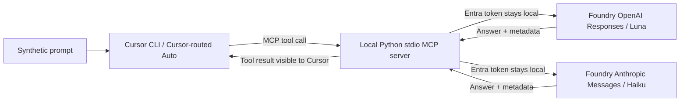

# Investigation: Cursor inference through Microsoft Foundry

## Executive conclusion

There are three separate compatibility questions:

1. **Can the model be called through Foundry?** Yes: both a GPT-6 Luna
   deployment and a Claude Haiku 5.5 deployment were invoked successfully with
   Microsoft Entra authentication.
2. **Can a client speak the model's API?** Yes, but the API route and
   model-specific parameters matter. Haiku accepts native Anthropic Messages.
   The same deployment also accepted OpenAI Responses, streaming, and function
   tools in live tests; it did not accept Chat Completions.
3. **Will Cursor use that endpoint as its main inference provider?** For the
   tested CLI and documented Cloud Agents surfaces, no supported Azure/Foundry
   route was established. API compatibility alone does not provide a provider
   routing setting that Cursor does not expose.

The working solution in this repository is therefore **Cursor CLI orchestration
with Foundry inference delegated to two MCP tools**. It is not a claim that
all Cursor inference, billing, or data processing has moved into Azure.

Source keys such as [C1] and [M1] refer to [SOURCES.md](SOURCES.md).

## 1. Scope and evidence quality

All experiments used one Foundry resource (Sweden Central) and one Foundry
project resolved through Azure Resource Manager:

`https://<resource>.services.ai.azure.com/api/projects/<project>`

Published evidence is in [`evidence-snapshot/`](evidence-snapshot/). It is
generated by `scripts/snapshot_evidence.py`, which replaces the subscription
ID, resource group, Foundry resource and project names, local paths and
unrelated deployment names with placeholders such as `my-foundry-resource`.
Response IDs, hashes, token usage, HTTP statuses and model behavior are kept.
All model creation and inference used the selected project's parent account;
no other Azure resource was modified.

The installed Cursor CLI was inspected and executed, not inferred from IDE
documentation. Azure control-plane metadata, HTTP results, SDK response IDs,
token usage, and fresh arithmetic challenges were captured locally. Sources
are distinguished as official documentation, staff forum responses, community
reports, or observed behavior. A forum feature request is not a release note.

This is a functional integration PoC, not a penetration test, compliance
certification, throughput benchmark, or full production agent evaluation.
No confidential repository was supplied to Cursor; only the synthetic `demo`
workspace was used.

## 2. Cursor CLI: the endpoint flag is not an inference base URL

### What the actual CLI exposes

The installed help shows:

- `--api-key` / `CURSOR_API_KEY`: Cursor authentication.
- `--endpoint` / `CURSOR_API_ENDPOINT`: defaults to `https://api2.cursor.sh`.
- `--model`: selects models known to Cursor.
- MCP configuration and tool commands.
- `bedrock configure`, `bedrock enable`, and related commands.

There is no Azure endpoint/deployment/provider-key option in the inspected
help. The documented CLI configuration schema also has no Azure provider
block. Project-level `cli.json` controls permissions, not arbitrary provider
configuration. [C1, C2, C3]

**Important qualification:** the Bedrock commands mean a blanket statement that
the CLI has "no BYOK of any kind" would be too broad for this installed version.
Bedrock integration is not evidence that Azure Foundry is supported. It was
not configured or tested here. [C9]

### Black-box endpoint experiment

`probe_cursor_routing.py` starts a loopback-only listener, passes a deliberately
invalid synthetic Cursor API key, and points `--endpoint` at that listener.
It records method/path/content-type only, discarding request bodies and
credential headers.

Observed first request:

```text
POST /auth/exchange_user_api_key
Content-Type: application/json
```

That is a Cursor authentication exchange, not `/responses`,
`/chat/completions`, or `/messages`. An Azure inference endpoint cannot satisfy
this exchange merely by receiving an Azure key. This probe stopped at
authentication; it does not claim to implement or document Cursor's complete
private backend protocol.

A separate authenticated Auto run set `OPENAI_BASE_URL`, `OPENAI_API_BASE`,
`AZURE_OPENAI_ENDPOINT`, and `ANTHROPIC_BASE_URL` to the listener, with dummy
provider keys. Cursor returned the requested marker and the listener saw
**zero requests**. This demonstrates that those variables did not redirect
that Auto run, not that every possible provider/configuration has been tested.

Evidence: [`cursor-routing.json`](evidence-snapshot/cursor-routing.json).

### Why the linked forum answers are not CLI configuration instructions

The Azure OpenAI settings discussed in the Foundry thread are IDE settings.
The CLI-specific Azure feature request reports that IDE settings and
OpenAI/Azure environment variables do not affect CLI routing. A separate CLI
custom-endpoint request describes the same misleading `--endpoint` flag.
[F1, F4, F5]

OpenAI's current integration guidance explicitly excludes Cursor CLI and Cloud
Agents from its local-desktop OpenAI-key/gateway instructions. That source
itself says Cursor's functionality may change, so the live CLI evidence and
the Bedrock exception above are important qualifications. [O1]

**Do not use a command such as `cursor chat --endpoint <azure-url>
--deployment <name>` copied from an unverified summary.** It is not the
installed CLI's supported interface.

## 3. The working Cursor CLI PoC



The official MCP Python SDK handles protocol framing, initialization, tool
schemas, and errors. The model clients use the official OpenAI and Anthropic
SDKs. `AzureCliCredential` obtains tokens for `https://ai.azure.com/.default`
using the configured subscription. No resource key was retrieved. [C4, M1, M2]

The two tools are:

| Tool | Fixed destination (from config) | API |
| --- | --- | --- |
| `foundry_openai` | `cursor-poc-gpt-6-luna` | OpenAI Responses |
| `foundry_claude` | `claude-haiku-5-5` | Anthropic Messages |

The caller cannot provide an endpoint, credential, shell command, or file
path. Tools accept bounded text and an output-token limit. The workspace
denies shell, file-read, file-write and web-fetch tools. This is defense in
depth for the experiment, not an OS-level isolation guarantee.

### What proves the inference really happened

`verify_cursor.py` generates fresh random arithmetic inputs and nonce markers,
then asks the actual Cursor CLI to call both tools. It requires:

- Successful Cursor completion and both correct answers.
- New audit records from the local model client, not old responses.
- Exact input-body SHA-256 matches for the requested model-specific requests.
- Exact response-text SHA-256 matches.
- Matching Azure response IDs in Cursor's final result.
- Both configured deployment identities.

The result is in [`cursor-mcp-e2e.json`](evidence-snapshot/cursor-mcp-e2e.json). This is stronger than asking
an agent which model it thinks it used. It is still local test evidence rather
than independent Azure billing attestation.

In the recorded final paired Cursor run, the delegated calls used **62 Luna
tokens (40 in / 22 out) and 75 Haiku tokens (53 in / 22 out)**. Cursor also
used its own orchestration tokens;
they are reported separately in the file. The small delegated tasks do not
establish that this architecture is cheaper than native Cursor inference.

### Windows-specific issues actually encountered

| Issue | Observed fix |
| --- | --- |
| MCP `enable` did not find the server when invoked only with `--workspace` from the parent directory | Change the process working directory to `demo` before MCP management commands |
| `${workspaceFolder}` plus parent-relative Windows executable paths failed with "The system cannot find the path specified" | Use normalized absolute executable/script paths; `Setup.ps1` regenerates them |
| Changing MCP configuration invalidated approval | Re-approve only `foundry-models`; do not blanket-approve all MCP servers |
| Explicit Composer 2.5 was refused with "Model unavailable on Free" | Use the account-supported `auto` orchestrator; do not upgrade the subscription |
| Luna's response `model` field was the deployment alias | Correlate with Azure control-plane model/version metadata rather than requiring a catalog model ID in that field |

## 4. Haiku: actual API format results

### Do not conflate three APIs

| API | Request shape | Tool shape | Text/stream shape |
| --- | --- | --- | --- |
| OpenAI Responses | `input`, `max_output_tokens`, nested `reasoning` | `function_call` and `function_call_output` | `output` items; `response.output_text.delta` events |
| OpenAI Chat Completions | `messages`, `max_tokens` or `max_completion_tokens` | `tool_calls` and role `tool` | `choices[].message`; chat-completion chunks |
| Anthropic Messages | `messages`, required `max_tokens`, top-level `system`, `thinking` | `tool_use` and `tool_result` content blocks | `content` blocks; message/content-block events |

Changing the hostname is not enough when the client speaks the wrong API.
System messages, reasoning controls, tool-call IDs, tool results, stop reasons,
stream events, and token accounting all have format-specific semantics.

### Results against the tested Haiku deployment

| Destination | Result |
| --- | --- |
| `https://<resource>.services.ai.azure.com/anthropic/v1/messages` | **Works** with Entra auth; basic text, streaming and tool round trip verified |
| `https://<resource>.openai.azure.com/openai/v1/responses` | **Works in this account/deployment**; text, streaming and tool round trip verified |
| `https://<resource>.openai.azure.com/openai/v1/chat/completions` | **404**, `api_not_supported` |
| `https://<resource>.services.ai.azure.com/anthropic/v1/chat/completions` | **404**, `api_not_supported` |

Evidence: [`claude-api-formats.json`](evidence-snapshot/claude-api-formats.json),
[`claude-responses-features.json`](evidence-snapshot/claude-responses-features.json),
[`claude-anthropic-features.json`](evidence-snapshot/claude-anthropic-features.json),
and the direct/MCP smoke files in [`evidence-snapshot/`](evidence-snapshot/).

**This is an important correction to a blanket "Claude cannot use an OpenAI
API" conclusion.** The current SDK overview still directs Claude users to the
separate Anthropic endpoint, while the actual Responses endpoint accepted
this deployment. Treat this as verified behavior of this account/model, not a
guarantee for every Foundry region, tenant, model, or API. The native Anthropic
route is the documented route and remains the main Haiku MCP implementation.
[M2, M3]

### Reasoning settings are not interchangeable

The Responses API rejected `reasoning: {"effort":"none"}` for Haiku with HTTP
400, listing `low`, `medium`, `high`, `xhigh`, and `max`. The feature test uses
`low` for Haiku and `none` for Luna.

Native Haiku accepted `thinking: {"type":"disabled"}` for these text/tool tests.
The PoC does not send sampling parameters copied from another Claude model.
These controls must remain provider- and API-specific even when both calls
use the OpenAI SDK.

### Solution built, and why no hand-written Chat Completions proxy was needed

For Cursor, the MCP bridge performs the operation at the **tool boundary**:
Cursor sends a small JSON tool argument; the bridge calls the appropriate
native SDK and returns a common text/metadata result. Cursor never needs to
speak Anthropic Messages itself.

For a client that supports OpenAI Responses, the same Foundry OpenAI base URL
can reach both tested deployments. `verify_model_features.py` demonstrates
that route with real streaming and complete tool-call continuation, not just
a one-message "hello".

If a future client is strictly Chat-Completions-only, use a maintained
translator such as LiteLLM's `azure_ai/` Anthropic provider, or implement a
separately tested gateway. LiteLLM documents translation, streaming and tool
handling; its advertised `/chat/completions` endpoint is the **proxy's**
interface, not proof that Azure's native Anthropic endpoint supports it.
LiteLLM was researched but **not installed or validated in this PoC**. [L1]

A bespoke translator was deliberately not added where the current Responses
API and native SDK already solved the tested requirement. Such a translator
would still not manufacture an Azure-provider override in Cursor CLI or
Cloud Agents.

## 5. How the requested forum threads fit together

| Source/time | What it establishes | What it does not establish |
| --- | --- | --- |
| Claude-via-Foundry feature request, December 2025 [F2] | Users wanted native Azure-hosted Claude support | Delivered support or a timeline |
| Community Azure/Claude proxy guide, December 2025 [F6] | An IDE OpenAI-to-Anthropic translation approach was demonstrated | CLI support or reliable Agent-mode compatibility |
| Same proxy author's March 2026 follow-up [F6] | Author mainly used Ctrl+K and had not used the proxy with an agent | A validated autonomous-agent solution |
| Anthropic base-URL request, May 2026 [F3] | No equivalent Anthropic override was available to the requester; staff confirms overridden OpenAI traffic traverses Cursor | An Azure-native CLI switch |
| Foundry support reply, June 2026 [F1] | IDE Azure slot supports Azure OpenAI-format use; Claude's different format was a limitation then | Universal impossibility of all later Foundry Responses compatibility |
| Enterprise gateway report, October 2026 [F7] | Community reports model-ID collisions/built-in routing can bypass expected gateway selection | A stable or officially supported model-alias hack |
| These live experiments, November 2026 | Both models work through local MCP; Haiku Responses works; Haiku Chat Completions fails | Native main-model Foundry routing in Cursor |

Do not send Azure credentials to the public Railway endpoint in the community
post. Its URL is a research reference, not a trusted service for this account.
No request or credential from this PoC was sent there.

## 6. Cursor Cloud Agents

### What the official surfaces currently support

Cloud Agents run in isolated remote environments and use a curated model
selection. Their public API creates/manages agents; it is not an OpenAI
inference API. The current create request accepts a model selection containing
an ID from Cursor's model catalog, optional parameters, an execution
environment, and MCP definitions. It does not expose a documented
`foundry_endpoint`/Azure deployment/provider credential override. [C5, C6]

The current API supports inline HTTP or stdio MCP configurations. The legacy
API documentation says MCP is not supported there. Do not copy the legacy
`source`/string-model body into a current integration. Prefer HTTP or stdio:
the capabilities page explicitly excludes SSE, despite an `sse` value
appearing in the current API reference. [C6, C7, C12]

The current API is in public beta. Its `envVars` field configures the agent's
shell/tool environment, not Cursor's model provider; the documentation also
warns that this field can be silently ignored for accounts where it has not
rolled out. Supplying `AZURE_OPENAI_ENDPOINT` there is therefore neither a
documented inference override nor a reliable substitute for validating the
tool environment. [C6]

### Viable cloud architecture, not executed


The included `config/cloud-agent.request.example.json` is a **request-shape
blueprint**, not a deployable service. Its `.invalid` hostname and token
placeholder are intentional. The local stdio server is not publicly exposed,
has no HTTP authentication implementation, and cannot be reached from a
Cursor-hosted VM as `localhost`.

To turn this into a cloud integration, the missing prerequisites are:

1. A Cursor plan/account with Cloud Agent access and a supported user/service
   API key.
2. An authenticated, network-reachable MCP service with the two fixed inference
   tools, preferably running in Azure and using managed identity.
3. Least-privilege model-inference permissions and an explicit network/data
   handling policy.
4. A real Cloud Agent run with fresh nonce/output-hash correlation against
   the gateway's Azure request logs.

   The example omits `repos` and `env`, using the documented no-repository agent
   shape. It omits `model` to use Cursor's configured default, not to select a
   Foundry deployment. Its JSON structure was compared with the official current
   create-agent schema; no authenticated create request was submitted.

No billing upgrade, Cursor API-key creation, public gateway deployment, new
Entra application, federation trust, or IAM assignment was performed.

### Why cloud runtime testing stopped

The environment had no `CURSOR_API_KEY`. Browser-based CLI login is not a
substitute for the documented public Cloud Agents API credential. The
installed CLI also identified the account as Free when refusing a paid
model. Official Cloud Agents documentation says Free and Plus do not include
Cloud Agents. The cloud runtime path is therefore **not verified here**; it
must not be advertised as working merely because the same MCP tool works
locally. [C3, C5]

### OIDC is useful, but not automatic Azure access

Cursor documents short-lived OIDC tokens minted over the agent's local socket.
The current issuer is `https://api.cursor.com`, token lifetime is five minutes,
and the verifier must validate audience and subject/claims. A properly
configured Entra federated identity could avoid a long-lived Azure secret in
the VM. A Cursor OIDC token itself is not a Foundry bearer token: trust and
token exchange still have to be established. This was researched, not
configured. [C10]

### Self-hosted workers do not solve inference ownership

Cursor explicitly states that a self-hosted worker performs tools, file edits,
terminal commands and local MCP execution while Cursor retains the agent
loop, inference and planning. Moving that worker onto an Azure VM does not
move the main model into a Foundry deployment. Relevant file contents and tool
results still leave the worker for Cursor. [C8]

## 7. Privacy, credentials, billing, and residency

| Concern | Actual behavior / limitation |
| --- | --- |
| Azure credentials | Obtained locally through Entra and sent only to the configured Azure service. No Azure resource key was fetched or saved. |
| Cursor's visibility | Cursor sees the user prompt, MCP arguments, returned text and metadata; using Foundry for a tool does not create an Azure-only data boundary. |
| IDE BYOK privacy | Official docs say keys accompany requests through Cursor's backend for prompt building, and their stated BYOK retention policy differs from Cursor-hosted inference. This is an IDE consideration, not what the local MCP server does. [C11] |
| Main-model cost | Cursor inference remains a separate usage lane. MCP does not transfer all Cursor tokens to Azure commitments. |
| Foundry cost | The newly created Luna SKU is pay-per-token, not provisioned throughput. Capacity limits throughput, not total spend. No account-specific dollar invoice was queried. |
| Luna residency | DataZoneStandard in Sweden Central uses the Microsoft-defined EU data zone, not a guarantee of inference exclusively in Sweden. [M5] |
| Haiku residency | Existing deployment is GlobalStandard; native response usage reported `inference_geo: global`. Do not claim EU-only processing. |
| Response storage | OpenAI Responses requests use `store: false`. That flag is not a blanket promise about provider logging, safety processing, or Cursor retention. |
| Audit contents | Successful-call metadata, hashes and usage are recorded; no prompt, answer or credential is written to the audit stream. Synthetic test artifacts intentionally include their test text. |
| Error behavior | No model fallback or silent retry; incomplete/empty responses are failures. SDK error bodies are not echoed through the core inference tools. |
| Local permissions | Only named inference tools are allowlisted; no `--force` or blanket MCP approval is used. This does not replace a production sandbox. |

Cloud Agent conversations and environment snapshots have their own retention
and secret-handling rules. A stdio server inside the cloud VM exposes its
configuration/environment to that VM. Official documentation recommends
HTTP MCP for separating server credentials from the agent VM. [C7, C13]

## 8. Verification and limits

| Check | Evidence (in `evidence-snapshot/`) | Outcome |
| --- | --- | --- |
| Luna creation and repeat deployment command | `deployment-created.json`, `deployment.json` | Created once; repeat did not modify the model |
| Haiku reuse and other deployments preserved | `deployment-inventory.json` | Haiku and the account's pre-existing deployments remain present (other names omitted from the public snapshot) |
| Direct Luna and native Haiku calls | `openai-direct-smoke.json`, `claude-direct-smoke.json` | Passed |
| SDK MCP client to both models | `openai-mcp-smoke.json`, `claude-mcp-smoke.json` | Passed |
| Actual installed Cursor CLI to both models | `cursor-mcp-e2e.json` | Passed with hashes/IDs correlated |
| Luna Responses streaming + tool continuation | `openai-responses-features.json` | Passed |
| Haiku Responses streaming + tool continuation | `claude-responses-features.json` | Passed |
| Haiku native streaming + tool continuation | `claude-anthropic-features.json` | Passed |
| Haiku endpoint compatibility | `claude-api-formats.json` | Responses 200; both Chat Completions routes 404 |
| CLI endpoint/auth distinction and environment overrides | `cursor-routing.json` | Observed Cursor auth exchange; Auto did not use provider overrides |
| Input, destination, missing-config, error, audit, MCP rejection tests | `unit-tests.txt` | Seven tests passed, including multiple edge cases |
| Live Cloud Agent | `environment.json` and plan requirements | Not run; account prerequisites missing |
| IDE native BYOK / public proxy | Research only | Not validated in this environment |

Streaming tests verify text deltas and final completion. Tool tests verify one
function call, exact arguments, a correctly correlated result, and a final
answer. They do not establish support for all parallel tools, multimodal
inputs, long-context behavior, thinking signatures, server tools, or every
structured-output option.

An initial tool-round-trip check asked for a marker without an exact formatting
contract; valid model wording failed its strict assertion. The final tests
explicitly request `marker:<integer>` with no spaces or Markdown and check the
real continuation against that contract. This corrected the test, not the
provider's protocol.

## 9. Recommendations

**For this experiment:** use the provided local MCP bridge. It is the path
actually verified with the installed Cursor CLI and both deployed models.

**For the Cursor IDE with OpenAI-format models:** Cursor documents an Azure
OpenAI API-key slot, and Cursor staff state that it works for OpenAI-format
Foundry deployments but not for Claude. It uses a resource key, and requests
pass through Cursor's backend. This path was researched, not validated here.
[C11, F1]

**For a Responses-capable custom application:** the unified Foundry Responses
route worked for both models; retain deployment-specific reasoning controls
and run the compatibility tests in each target environment.

**For durable native Claude integration:** prefer the documented Anthropic
Messages SDK route. The MCP wrapper already implements it.

**If the hard requirement is that all agent inference be billed and processed
through your own Foundry account:** this PoC does not satisfy that requirement,
and a generic OpenAI proxy does not fix the missing Cursor CLI/Cloud provider
control. Use an agent/runtime with explicit Foundry provider support, or obtain
a supported Cursor enterprise integration with verifiable routing guarantees.

---

API naming note: this report uses "current" and "legacy" for API shapes. At the
time of the investigation, the current Cloud Agents API used `/v1` durable
agents plus runs; the legacy API used `/v0`. Sources and experiments were
checked on 17 November 2026 local time; UTC evidence timestamps can show
16 November. Findings are specific to those observed versions and resources.
