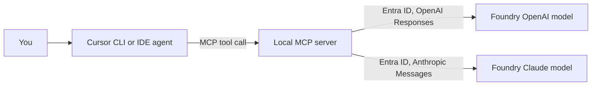

# Cursor + Microsoft Foundry

**Use Microsoft Foundry models (OpenAI and Anthropic Claude) from the Cursor
CLI, the Cursor IDE and Cursor Cloud Agents.** This repo includes tested
proofs of concept, setup guides for each surface and a source-cited
investigation of what Cursor supports today.

- **Website:** https://salnikov.no/cursor-microsoft-foundry/
- **Guides:** [Foundry setup](docs/setup.md) · [CLI](docs/cli.md) ·
  [IDE](docs/ide.md) · [Cloud Agents](docs/cloud.md)
- **Full findings:** [FINDINGS.md](FINDINGS.md) · **Sources:** [SOURCES.md](SOURCES.md)

> Independent research. Not affiliated with or endorsed by Cursor (Anysphere)
> or Microsoft. Verified on Windows 11 with Cursor CLI `2026.11.13-eacade1`
> and Cursor IDE `3.30.14` in November 2026. Cursor and Foundry change
> quickly; check the sources.

## Results by surface

| Surface | Foundry models as tools (MCP) | Foundry model as Cursor's chat model | Status |
| --- | --- | --- | --- |
| [Cursor CLI](docs/cli.md) | **Works.** Verified end to end with GPT-6 Luna and Claude Haiku 5.5. | No setting. `--endpoint` points at Cursor's service; provider environment variables are ignored. | Verified |
| [Cursor IDE](docs/ide.md) | **Works.** The same MCP server, verified end to end in the Agent panel. | OpenAI-format deployments through the Azure OpenAI API-key slot (Cursor staff confirm; not tested here with a key). No path for Claude. | MCP verified; key slot documented |
| [Cloud Agents](docs/cloud.md) | By design, through an authenticated HTTP MCP service in Azure. | No provider setting. | Blueprint, not run (needs a paid plan) |

Two API findings apply to every surface:

- The tested Claude deployment accepted the OpenAI Responses API and the
  Anthropic Messages API. Its Chat Completions routes returned 404, so a
  client that only speaks Chat Completions can't reach it.
- The Luna deployment accepted every request shape the IDE key slots can send,
  except Chat Completions with a Responses-style `reasoning` object (400
  `unknown_parameter`).

## Quick start

Prerequisites: an Azure subscription with a Foundry resource and project,
Azure CLI (`az login`), PowerShell 7, Python 3.12+, and the Cursor CLI
(`agent login`) or IDE. Follow the [Foundry setup](docs/setup.md) for model
deployment and role assignment.

```powershell
git clone https://github.com/webmaxru/cursor-microsoft-foundry.git
cd cursor-microsoft-foundry
Copy-Item config/foundry.example.json config/foundry.json   # then edit it
./scripts/Setup.ps1
./scripts/Run-Poc.ps1
```

Then use the tools from the `demo` folder.

- **CLI:**

  ```powershell
  agent mcp enable foundry-models
  agent --mode ask --model auto --print --trust "Call foundry_openai and foundry_claude, each with the prompt 'In one sentence, what is a Python list comprehension?'. For each tool, report its text, deployment and response_id. Do not read files or run shell commands."
  ```

- **IDE:** open `demo` as a folder, turn on `foundry-models` in
  **Cursor Settings → Customize → MCPs**, and ask the Agent to call the tools.
  See the [IDE guide](docs/ide.md#path-a-foundry-models-as-mcp-tools).

Foundry inference is billed to your Azure subscription. Cursor's own model
(for example, `auto`) still runs on Cursor's service.

## How it works



The MCP server authenticates with your Azure CLI login. No API key is
created or stored, and the Azure credential never reaches Cursor. Prompts and
answers passed through the tools are visible to both Cursor and Foundry.

## Contents

| Path | Purpose |
| --- | --- |
| [`docs/setup.md`](docs/setup.md) | Foundry setup for every surface: OpenAI and Claude deployments, access, bridge |
| [`docs/cli.md`](docs/cli.md), [`docs/ide.md`](docs/ide.md), [`docs/cloud.md`](docs/cloud.md) | Guides for the Cursor CLI, IDE and Cloud Agents |
| [`FINDINGS.md`](FINDINGS.md) | Investigation: results by surface, API formats, forum threads, privacy, billing |
| [`SOURCES.md`](SOURCES.md) | Annotated sources (Cursor docs, forum threads, Microsoft Learn, SDKs) |
| [`scripts/`](scripts/) | MCP server, Foundry clients, setup, deployment, verification and probe scripts ([reference](docs/scripts.md)) |
| [`config/`](config/) | Configuration template and the Cloud Agents request blueprint |
| [`demo/`](demo/) | Cursor workspace with the MCP config and tool permissions |
| [`tests/`](tests/) | Unit tests (`python -m unittest discover -s tests -v`) |
| [`evidence-snapshot/`](evidence-snapshot/) | Redacted results from the live runs ([index](docs/evidence.md)) |
| [`docs/assets/`](docs/assets/) | Screenshots of the Cursor IDE settings and the MCP run |
| [`site/`](site/) | Static site generator for GitHub Pages |

## Clean up

Turn off `foundry-models` in the CLI (run `agent mcp disable foundry-models`
in `demo`) or in the IDE (**Cursor Settings → Customize → MCPs**). Then delete
the deployments you created for this guide, for example:

```powershell
az cognitiveservices account deployment delete -g <resource-group> -n <resource> --deployment-name <deployment-name>
```

## License

[MIT](LICENSE)
