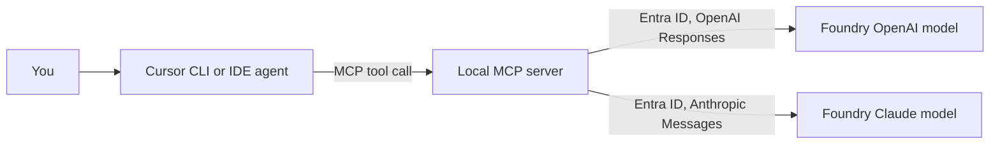

# Cursor + Microsoft Foundry

**Can Cursor fully switch to Microsoft Foundry the way Claude Code does?** This
repo answers that for the Cursor CLI, the Cursor IDE and Cursor Cloud Agents
with OpenAI and Anthropic Claude models. It includes tested proofs of concept,
setup guides for each surface, every disadvantage of the closest option and a
source-cited investigation.

**Short answer:** there is no full switch like Claude Code's. The IDE has a
partial one: chat and Agent models on your Foundry OpenAI deployment through
the Azure OpenAI slot, on a paid plan. It is reported working, but was not
run here with a real key: entering one needs its owner, and the steps are
prepared. The CLI and Cloud Agents have none, and Cursor
refused custom models behind a LiteLLM gateway on every surface, even on a
Premium plan. Claude on Foundry has no native route; a translating proxy works
when called directly, but Cursor sent it nothing. Where there is none, Foundry
models were verified as MCP tools in the earlier arithmetic proof. New native
CLI sessions failed tool discovery; the [development study](docs/development.md)
tests and clearly labels a shell-invoked MCP-client alternative.

- **Website:** https://salnikov.no/cursor-microsoft-foundry/
- **Guides:** [Full switch](docs/fullswitch.md) · [Foundry setup](docs/setup.md) ·
  [CLI](docs/cli.md) · [IDE](docs/ide.md) · [Cloud Agents](docs/cloud.md)
- **Full findings:** [FINDINGS.md](FINDINGS.md) · **Sources:** [SOURCES.md](SOURCES.md)
- **Development study:** [Does MCP work for real development?](docs/development.md)

The three-stage coding comparison completed through a **shell-invoked MCP
client**, not native CLI dispatch: eight successful Foundry calls, **24.9 versus
13.0 minutes**, and **52.4% more Cursor output tokens**. Both passed the planned
acceptance checks, but follow-up probes found validation and encoding gaps.
The [unchanged application artifacts](examples/ledger-lab/) and separate
provider counters are published, including the failures.

> Independent research. Not affiliated with or endorsed by Cursor (Anysphere)
> or Microsoft. Verified on Windows 11 with Cursor CLI `2026.11.13-eacade1`
> and Cursor IDE `3.30.14` (Free plan, then an individual Premium plan) in
> November 2026, with LiteLLM 1.108.4 and 1.109.1. Cursor and Foundry change
> quickly; check the sources.

## Results by surface

| Surface | Full switch to Foundry? | Fallback: Foundry models as tools (MCP) | Status |
| --- | --- | --- | --- |
| [Cursor IDE](docs/ide.md) | **Partial.** Chat and Agent models through the Azure OpenAI slot, OpenAI deployments only, paid plan, requests pass through Cursor's servers. A gateway behind the OpenAI base URL override was refused on 3.30.14. Claude has no native route; a translating proxy passed 15 of 15 direct cases, but Cursor sent it nothing. | **Works.** The same MCP server, verified end to end in the Agent panel. | Azure slot passed the plan gate with a dummy key; real-key run prepared, not done. Gateway: 0 requests from Cursor |
| [Cursor CLI](docs/cli.md) | **No.** `--endpoint` is Cursor's service, `--model` takes only Cursor's catalog ("Cannot use this model" on Premium), provider environment variables are ignored. | Historical arithmetic proof passed; native tool discovery failed in new coding sessions. | See the [development study](docs/development.md) for the shell-MCP workaround and measured limits |
| [Cloud Agents](docs/cloud.md) | **No, by design.** Cursor staff say keys come from the IDE client, which headless runs lack. A custom model gave "Model Not Available" on Premium. | By design, through an authenticated HTTP MCP service in Azure. | No switch; MCP blueprint not run (needs a Cursor API key and a public MCP service) |

Claude Code, by comparison, calls Foundry directly from your machine with
`CLAUDE_CODE_USE_FOUNDRY=1`. See [Full switch](docs/fullswitch.md) for the
side-by-side, the community evidence and what I could not find.

Two API findings apply to every surface:

- The tested Claude deployment accepted the OpenAI Responses API and the
  Anthropic Messages API. Its Chat Completions routes returned 404, so a
  client that only speaks Chat Completions can't reach it without a gateway.
- The Luna deployment accepted the request shapes the IDE key slots can send,
  except Chat Completions with a Responses-style `reasoning` object (400
  `unknown_parameter`), legacy `max_tokens` (400), and function tools unless
  `reasoning_effort` is `none` (400).

## Quick start (the MCP fallback)

Prerequisites: an Azure subscription with a Foundry resource and project,
Azure CLI (`az login`), PowerShell 7, Python 3.12+, and the Cursor CLI
(`agent login`) or IDE. Follow the [Foundry setup](docs/setup.md) for model
deployment and role assignment. For the IDE's own-key route, see the
[IDE guide](docs/ide.md#main-option-the-azure-openai-slot).

```powershell
git clone https://github.com/webmaxru/cursor-microsoft-foundry.git
cd cursor-microsoft-foundry
Copy-Item config/foundry.example.json config/foundry.json   # then edit it
./scripts/Setup.ps1
./scripts/Run-Poc.ps1
```

Then use the tools from the `demo` folder.

- **CLI:**

  ```powershell
  agent mcp enable foundry-models
  agent --mode ask --model auto --print --trust "Call foundry_openai and foundry_claude, each with the prompt 'In one sentence, what is a Python list comprehension?'. For each tool, report its text, deployment and response_id. Do not read files or run shell commands."
  ```

- **IDE:** open `demo` as a folder, turn on `foundry-models` in
  **Cursor Settings → Customize → MCPs**, and ask the Agent to call the tools.
  See the [IDE guide](docs/ide.md#fallback-foundry-models-as-mcp-tools).

Foundry inference is billed to your Azure subscription. Cursor's own model
(for example, `auto`) still runs on Cursor's service.

## How the MCP fallback works



The MCP server authenticates with your Azure CLI login. No API key is
created or stored, and the Azure credential never reaches Cursor. This is not
a switch: Cursor's model still runs the agent. Prompts and answers passed
through the tools are visible to both Cursor and Foundry.

## Contents

| Path | Purpose |
| --- | --- |
| [`docs/fullswitch.md`](docs/fullswitch.md) | Can Cursor fully switch to Foundry? Verdicts, the Claude Code comparison and community evidence |
| [`docs/setup.md`](docs/setup.md) | Foundry setup for every surface: OpenAI and Claude deployments, access, bridge, optional API-key access |
| [`docs/cli.md`](docs/cli.md), [`docs/ide.md`](docs/ide.md), [`docs/cloud.md`](docs/cloud.md) | Guides for the Cursor CLI, IDE and Cloud Agents |
| [`FINDINGS.md`](FINDINGS.md) | Investigation: results by surface, API formats, forum threads, privacy, billing |
| [`SOURCES.md`](SOURCES.md) | Annotated sources (Cursor docs, forum threads, Microsoft Learn, SDKs) |
| [`scripts/`](scripts/) | MCP server, Foundry clients, setup, deployment, verification, probe and capture-proxy scripts ([reference](docs/scripts.md)) |
| [`config/`](config/) | Configuration template, the Cloud Agents request blueprint and an example LiteLLM gateway config (rendered by `scripts/litellm_gateway.py`) |
| [`demo/`](demo/) | Cursor workspace with the MCP config and tool permissions |
| [`tests/`](tests/) | Unit tests (`python -m unittest discover -s tests -v`) |
| [`evidence-snapshot/`](evidence-snapshot/) | Redacted results from the live runs ([index](docs/evidence.md)) |
| [`docs/assets/`](docs/assets/) | Screenshots of the Cursor IDE settings and the MCP run |
| [`site/`](site/) | Static site generator and reading-interface regression tests for GitHub Pages |
| [`PRODUCT.md`](PRODUCT.md), [`DESIGN.md`](DESIGN.md) | Product constraints and the website's visual system |

## Clean up

Turn off `foundry-models` in the CLI (run `agent mcp disable foundry-models`
in `demo`) or in the IDE (**Cursor Settings → Customize → MCPs**). Then delete
the deployments you created for this guide, for example:

```powershell
az cognitiveservices account deployment delete -g <resource-group> -n <resource> --deployment-name <deployment-name>
```

## License

[MIT](LICENSE)
