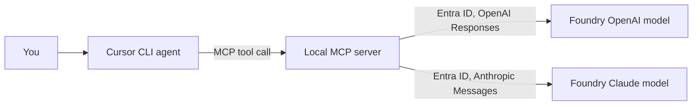

# Cursor + Microsoft Foundry

**Use Microsoft Foundry models (OpenAI and Anthropic Claude) from Cursor CLI.**
Includes a tested proof of concept, a step-by-step guide and a source-cited
investigation of what Cursor supports today.

- **Website:** https://webmaxru.github.io/cursor-microsoft-foundry/
- **Step-by-step guide:** [docs/guide.md](docs/guide.md)
- **Full findings:** [FINDINGS.md](FINDINGS.md) · **Sources:** [SOURCES.md](SOURCES.md)

> Independent research. Not affiliated with or endorsed by Cursor (Anysphere)
> or Microsoft. Verified on Windows with Cursor CLI `2026.11.13-eacade1` in
> November 2026. Cursor and Foundry change quickly; check the sources.

## Results

| Question | Answer |
| --- | --- |
| Can Cursor CLI use Foundry models? | **Yes, as tools.** A local MCP server exposes `foundry_openai` (GPT-6 Luna, OpenAI Responses API) and `foundry_claude` (Claude Haiku 5.5, Anthropic Messages API). Verified end to end with matching Azure response IDs and request and response hashes. |
| Can Cursor CLI send its **main** model traffic to Foundry? | No supported setting was found. `--endpoint` points at Cursor's own service, not at an OpenAI-compatible inference URL. |
| Can the Cursor IDE use a Foundry model as its chat model? | For **OpenAI-format** deployments, Cursor documents an Azure OpenAI API-key slot. Cursor staff say it doesn't work for Claude. Not tested here. |
| Does Claude on Foundry need an OpenAI-to-Anthropic proxy? | Not for clients that speak OpenAI Responses or Anthropic Messages. The tested Claude deployment accepted both; its Chat Completions routes returned 404. |
| Can Cursor Cloud Agents use Foundry? | Through an authenticated HTTP MCP service, by design. Not run: the test account had no Cursor API key, and its Free plan doesn't include Cloud Agents. |

## Quick start

Prerequisites: an Azure subscription with a Foundry resource and project,
Azure CLI (`az login`), PowerShell 7, Python 3.12+, and Cursor CLI
(`agent login`). Follow the [guide](docs/guide.md) for model deployment and
role assignment.

```powershell
git clone https://github.com/webmaxru/cursor-microsoft-foundry.git
cd cursor-microsoft-foundry
Copy-Item config/foundry.example.json config/foundry.json   # then edit it
./scripts/Setup.ps1
./scripts/Run-Poc.ps1
```

Then, from the `demo` folder:

```powershell
agent mcp enable foundry-models
agent --mode ask --model auto --print --trust "Call foundry_openai and foundry_claude, each with the prompt 'In one sentence, what is a Python list comprehension?'. For each tool, report its text, deployment and response_id. Do not read files or run shell commands."
```

Foundry inference is billed to your Azure subscription. Cursor's own
orchestration model (`auto`) still runs on Cursor's service.

## How it works



The MCP server authenticates with your Azure CLI login. No API key is
created or stored, and the Azure credential never reaches Cursor. Prompts and
answers passed through the tools are visible to both Cursor and Foundry.

## Contents

| Path | Purpose |
| --- | --- |
| [`docs/guide.md`](docs/guide.md) | Step-by-step setup for OpenAI and Claude models |
| [`FINDINGS.md`](FINDINGS.md) | Investigation: CLI, IDE, Cloud Agents, API formats, privacy, billing |
| [`SOURCES.md`](SOURCES.md) | Annotated sources (Cursor docs, forum threads, Microsoft Learn, SDKs) |
| [`scripts/`](scripts/) | MCP server, Foundry clients, setup, deployment and verification scripts ([reference](docs/scripts.md)) |
| [`config/foundry.example.json`](config/foundry.example.json) | Configuration template; copy to `config/foundry.json` |
| [`demo/`](demo/) | Cursor workspace with the MCP config and tool permissions |
| [`tests/`](tests/) | Unit tests (`python -m unittest discover -s tests -v`) |
| [`evidence-snapshot/`](evidence-snapshot/) | Redacted results from the live runs ([index](docs/evidence.md)) |
| [`site/`](site/) | Static site generator for GitHub Pages |

## Clean up

Delete the deployments you created for this guide, for example:

```powershell
az cognitiveservices account deployment delete -g <resource-group> -n <resource> --deployment-name <deployment-name>
```

## License

[MIT](LICENSE)
