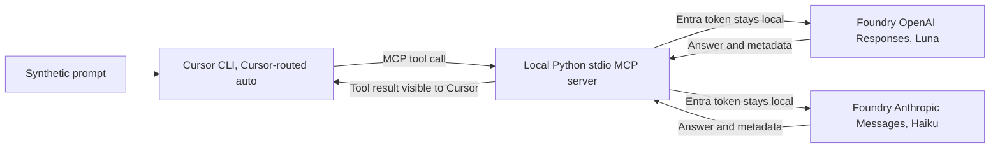

# Cursor CLI with Microsoft Foundry

**Verdict: no full switch.** The Cursor CLI has no setting that sends its own
model calls to Foundry, so nothing here resembles Claude Code's Foundry mode
[A3]. `--endpoint` points at Cursor's own service, `--model` accepts only
Cursor's catalog, and provider environment variables are ignored. The fallback
is to keep Cursor's model and let the CLI agent call Foundry deployments as
**MCP tools**. That was **verified end to end**, but the agent still runs on
Cursor.

| You want to... | Status |
| --- | --- |
| Make a Foundry deployment the CLI's main model | **Not possible** ([evidence](#why-there-is-no-switch)) |
| Point `--endpoint` at Foundry | Doesn't work: it is Cursor's own protobuf service |
| Use your own provider key, the way the IDE does | Not supported by the CLI [F25] |
| Let the CLI agent call Foundry OpenAI and Claude models as tools | **Verified**, [steps below](#fallback-foundry-models-as-mcp-tools) |

> **Tested with:** Cursor CLI `2026.11.13-eacade1` on Windows 11 and a Cursor
> Free account (17 November 2026). The MCP fallback needs
> [Foundry setup](setup.md) steps 1 to 7.

## Why there is no switch

I tested each place a switch could live.

### `--endpoint` is Cursor's service, not an inference base URL

`agent --help` lists `--endpoint` / `CURSOR_API_ENDPOINT`, defaulting to
`https://api2.cursor.sh`. To see what that endpoint is used for,
`scripts/probe_cli_fullswitch.py` starts a loopback listener, signs in with
the real account, and points `--endpoint` at the listener. It records only
method, path, header names and content type
([`cli-fullswitch.json`](../evidence-snapshot/cli-fullswitch.json)).

The CLI made these calls, all `POST` with `application/proto` bodies, and
then exited with `Error: [unimplemented]`:

```text
/aiserver.v1.DashboardService/GetMe
/aiserver.v1.ServerConfigService/GetServerConfig
/aiserver.v1.DashboardService/GetTeamAdminSettingsOrEmptyIfNotInTeam
/aiserver.v1.DashboardService/GetTeamReposOrEmptyIfNotInTeam
/aiserver.v1.DashboardService/ListMarketplaces
```

These are Connect calls to Cursor's `aiserver.v1` services. None is an OpenAI
Chat Completions, Responses or Anthropic Messages request, and Azure can't
answer them. The listener answered nothing, so the CLI never got as far as an
inference call. That is a limit of this test, but the endpoint's role is clear
from the first requests. Each request carries an `authorization` header, so
`--endpoint` sends your **Cursor credential** to whatever you point it at.

With a deliberately invalid synthetic key the first request is instead
`POST /auth/exchange_user_api_key` with a JSON body
([`cursor-routing.json`](../evidence-snapshot/cursor-routing.json)), Cursor's
key exchange. The probe doesn't document Cursor's private protocol.

### `--model` accepts only Cursor's catalog

`agent --model cursor-poc-gpt-6-luna` was refused before any request:

```text
Cannot use this model: cursor-poc-gpt-6-luna. Available models: auto, gpt-5.3-codex-low, ...
```

The names are Cursor's own catalog entries, not your deployments.

### No provider flags, and environment variables are ignored

- **Commands.** The installed CLI offers `persist`, `login`, `logout`, `mcp`,
  `plugin`, `worker`, `status`, `models`, `team`, `bedrock`, `about`, `update`,
  `create-chat`, `generate-rule`, `agent`, `ls`, `resume` and `help`.
  `bedrock` is the only cloud-provider command.
- **Authentication.** Only `agent login` or `CURSOR_API_KEY`, which is a
  Cursor key [C3]. There is no provider key option.
- **Configuration.** The documented schema has no provider block; project
  `cli.json` controls permissions, not providers [C1, C2].
- **Environment variables.** An authenticated `auto` run set `OPENAI_BASE_URL`,
  `OPENAI_API_BASE`, `AZURE_OPENAI_ENDPOINT` and `ANTHROPIC_BASE_URL` to a
  listener, with dummy provider keys. Cursor answered normally and the
  listener saw **zero requests**
  ([`cursor-routing.json`](../evidence-snapshot/cursor-routing.json)).

### What staff and users say

- In November 2026 a Cursor staff member answered a "provider API keys with
  the CLI" thread: the CLI doesn't support them [F25].
- A February 2026 thread reports that IDE Azure settings and provider
  environment variables don't affect the CLI [F4]. A long-running request for
  a custom CLI endpoint remains open [F5].
- OpenAI's guidance for using its models in Cursor excludes the CLI and Cloud
  Agents from its own-key steps [O1].
- Cursor staff explain the Cloud side by saying own keys are attached by the
  IDE client on each request, and that the same applies to the CLI [F23].

### Bedrock is not Azure

The CLI ships `bedrock` commands, so "the CLI has no bring-your-own model of
any kind" would be too broad. Bedrock is AWS only and was not configured here.
It is not evidence of Azure or Foundry support [C9].

### An unofficial bridge exists

A community project says it runs the Cursor agent CLI against OpenAI- or
Anthropic-compatible APIs [G1]. I did not install it or evaluate how it works,
so I can't say whether it is safe, supported or complete. Weigh it as you would
any third-party tool that handles your credentials.

> Do not use a command such as `cursor chat --endpoint <azure-url>
> --deployment <name>` copied from an unverified summary. It is not part of
> the installed CLI.

## Fallback: Foundry models as MCP tools

Since there is no switch, keep Cursor's model as the agent and let it call your
Foundry deployments as tools. The agent still runs on Cursor, and Cursor sees
every tool argument and result. Only the Azure credential stays on your
machine. The steps need a free Cursor account and `--model auto`.

### 1. Install and sign in

```bash
# macOS, Linux, WSL
curl https://cursor.com/install -fsS | bash
```

```powershell
# Windows PowerShell
irm 'https://cursor.com/install?win32=true' | iex
```

```powershell
agent --version
agent login
```

### 2. Connect the MCP server

Cursor reads `.cursor/mcp.json` from the folder it runs in.
[`Setup.ps1`](setup.md#6-install-the-bridge) wrote one to `demo`. Approve only
this server, then check that Cursor can load its tools:

```powershell
cd demo
agent mcp enable foundry-models
agent mcp list
agent mcp list-tools foundry-models
```

```text
foundry-models: ready
Tools for foundry-models (2):
- foundry_claude (prompt, max_output_tokens)
- foundry_openai (prompt, max_output_tokens)
```

The demo's `.cursor/cli.json` allows only these two tools and denies shell,
file and web tools:

```json
{
  "permissions": {
    "allow": ["Mcp(foundry-models:foundry_openai)", "Mcp(foundry-models:foundry_claude)"],
    "deny": ["Shell(*)", "Read(**)", "Write(**)", "WebFetch(*)"]
  }
}
```

### 3. Ask Cursor to use your Foundry models

From the `demo` folder:

```powershell
agent --mode ask --model auto --print --trust "Call foundry_openai and foundry_claude, each with the prompt 'In one sentence, what is a Python list comprehension?'. For each tool, report its text, deployment and response_id. Do not read files or run shell commands."
```

Real output (exit code 0, about 30 seconds):

```text
**foundry_openai**
- **text:** A Python list comprehension is a concise way to create a list by transforming or filtering items from an iterable in a single expression.
- **deployment:** `cursor-poc-gpt-6-luna`
- **response_id:** `resp_0c6f4d57c8f858d0016afb99a9766c81958a84539c773a7180`

**foundry_claude**
- **text:** A Python list comprehension is a concise syntax for creating a new list by applying an expression to each item in an iterable, optionally filtering items with a condition, as in `[x * 2 for x in range(5) if x % 2 == 0]`.
- **deployment:** `claude-haiku-5-5`
- **response_id:** `msg_011Ch7X7ugJReAnRB6NoRKdT`
```

Both response IDs match records that the MCP server wrote to its local audit
log (`evidence/foundry-audit.jsonl`) when Azure responded, so they come from
real Azure calls, not from model-generated text. The published copies are
[`guide-prompt-output.txt`](../evidence-snapshot/guide-prompt-output.txt) and
[`foundry-audit.jsonl`](../evidence-snapshot/foundry-audit.jsonl). Your text
and IDs will differ. The `resp_` prefix comes from the OpenAI Responses API
and the `msg_` prefix from the Anthropic Messages API.

### 4. Run the full end-to-end check

From the repository root:

```powershell
cd ..
./scripts/Run-Poc.ps1
```

This runs all four smoke tests, approves and lists the MCP server, and then
runs `scripts/verify_cursor.py`. That script asks Cursor to call both tools
with fresh random tasks. It passes only if Cursor's answer contains the
correct results **and** the request hashes, response hashes and response IDs
match new audit records. The recorded run is in
[`cursor-mcp-e2e.json`](../evidence-snapshot/cursor-mcp-e2e.json).

### 5. Use it in your own project

1. Copy `demo/.cursor/mcp.json` to `<your-project>/.cursor/mcp.json`, or to
   `~/.cursor/mcp.json` to make the tools available in every project.
2. Allow the two tools in `<your-project>/.cursor/cli.json`:

   ```json
   {
     "permissions": {
       "allow": ["Mcp(foundry-models:foundry_openai)", "Mcp(foundry-models:foundry_claude)"]
     }
   }
   ```

   The demo's `deny` rules exist to isolate the experiment. In a real project,
   set shell and file permissions to suit your own workflow.
3. Approve the server from that project folder:

   ```powershell
   agent mcp enable foundry-models
   ```

4. Ask for the tool by name, for example: *"Ask foundry_claude to review the
   function below for edge cases"*.

Each tool call accepts up to 8,000 characters and 128 to 2,048 output tokens.
Text you send to a tool goes to **both** Foundry and Cursor, because Cursor's
agent writes the tool arguments and reads the results.

## How the proof works



The official MCP Python SDK handles protocol framing and tool schemas. The
model clients use the official OpenAI and Anthropic SDKs, with
`AzureCliCredential` tokens for `https://ai.azure.com/.default`. The caller
can't supply an endpoint, credential, shell command or file path. [C4, M1, M2]

`verify_cursor.py` passes only when all of these hold:

- Cursor finishes successfully with both correct answers.
- New audit records exist from the local model client.
- Request-body and response-text SHA-256 hashes match exactly.
- Cursor's answer contains the matching Azure response IDs.
- Both configured deployments answered.

That is stronger than asking an agent which model it used, but it is local
test evidence, not Azure billing attestation. In the recorded run the
delegated calls used **62 Luna tokens (40 in, 22 out) and 75 Haiku tokens
(53 in, 22 out)**. Cursor's own orchestration tokens are reported separately
in [`cursor-mcp-e2e.json`](../evidence-snapshot/cursor-mcp-e2e.json).

## Troubleshooting

Problems with Azure, roles or deployments are covered in
[Foundry setup troubleshooting](setup.md#8-troubleshooting).

| Symptom | Cause and fix |
| --- | --- |
| `Model unavailable on Free` | Use `--model auto`. Explicit Composer 2.5 was refused on the Free plan. |
| `Cannot use this model: <deployment name>` | `--model` takes Cursor catalog names only. Your deployment is reachable through the tools, not as a model. |
| `Error: [unimplemented]` after setting `--endpoint` | The endpoint isn't a Cursor service. Remove `--endpoint`. |
| `agent mcp list-tools` can't find `foundry-models` | Run it from the folder that contains `.cursor/mcp.json`. Passing only `--workspace` from the parent folder did not work on Windows. |
| Cursor asks for approval again | Changing `mcp.json` resets approval. Run `agent mcp enable foundry-models` again; don't approve all servers at once. |
| "The system cannot find the path specified" | `${workspaceFolder}` with parent-relative paths failed on Windows. Run `./scripts/Setup.ps1` again to write absolute paths. |
| Luna's `model` field shows the deployment name | Expected. The scripts compare against Azure deployment metadata instead. |

## Disconnect

```powershell
cd demo
agent mcp disable foundry-models
```

Then [delete the deployments](setup.md#9-clean-up) you no longer need.

---

Source keys such as [C1] and [F4] refer to [Sources](../SOURCES.md).
