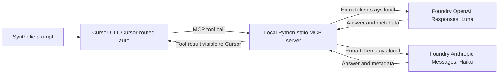

# Cursor CLI with Microsoft Foundry

**Verdict:** the Cursor CLI agent can call your Foundry OpenAI and Claude
deployments as **MCP tools**. This was **verified end to end** with the
installed CLI. The CLI has **no setting** that sends its own main model traffic
to Foundry: `--endpoint` is Cursor's service endpoint, and provider environment
variables are ignored.

| You want to... | Status |
| --- | --- |
| Let the CLI agent call Foundry OpenAI and Claude models as tools | **Verified**, steps below |
| Make a Foundry deployment the CLI's main model | No supported setting ([evidence](#what-does-not-work)) |
| Point `--endpoint` at Azure | Doesn't work: it is Cursor's auth and service endpoint |

> **Tested with:** Cursor CLI `2026.11.13-eacade1` on Windows 11 and a Cursor
> Free account (17 November 2026). Complete [Foundry setup](setup.md) steps 1
> to 7 first.

## 1. Install and sign in

```bash
# macOS, Linux, WSL
curl https://cursor.com/install -fsS | bash
```

```powershell
# Windows PowerShell
irm 'https://cursor.com/install?win32=true' | iex
```

```powershell
agent --version
agent login
```

A free Cursor account is enough for this page; use `--model auto`.

## 2. Connect the MCP server

Cursor reads `.cursor/mcp.json` from the folder it runs in.
[`Setup.ps1`](setup.md#6-install-the-bridge) wrote one to `demo`. Approve only
this server, then check that Cursor can load its tools:

```powershell
cd demo
agent mcp enable foundry-models
agent mcp list
agent mcp list-tools foundry-models
```

```text
foundry-models: ready
Tools for foundry-models (2):
- foundry_claude (prompt, max_output_tokens)
- foundry_openai (prompt, max_output_tokens)
```

The demo's `.cursor/cli.json` allows only these two tools and denies shell,
file and web tools:

```json
{
  "permissions": {
    "allow": ["Mcp(foundry-models:foundry_openai)", "Mcp(foundry-models:foundry_claude)"],
    "deny": ["Shell(*)", "Read(**)", "Write(**)", "WebFetch(*)"]
  }
}
```

## 3. Ask Cursor to use your Foundry models

From the `demo` folder:

```powershell
agent --mode ask --model auto --print --trust "Call foundry_openai and foundry_claude, each with the prompt 'In one sentence, what is a Python list comprehension?'. For each tool, report its text, deployment and response_id. Do not read files or run shell commands."
```

Real output (exit code 0, about 30 seconds):

```text
**foundry_openai**
- **text:** A Python list comprehension is a concise way to create a list by transforming or filtering items from an iterable in a single expression.
- **deployment:** `cursor-poc-gpt-6-luna`
- **response_id:** `resp_0c6f4d57c8f858d0016afb99a9766c81958a84539c773a7180`

**foundry_claude**
- **text:** A Python list comprehension is a concise syntax for creating a new list by applying an expression to each item in an iterable, optionally filtering items with a condition, as in `[x * 2 for x in range(5) if x % 2 == 0]`.
- **deployment:** `claude-haiku-5-5`
- **response_id:** `msg_011Ch7X7ugJReAnRB6NoRKdT`
```

Both response IDs match records that the MCP server wrote to its local audit
log (`evidence/foundry-audit.jsonl`) when Azure responded, so they come from
real Azure calls, not from model-generated text. The published copies are
[`guide-prompt-output.txt`](../evidence-snapshot/guide-prompt-output.txt) and
[`foundry-audit.jsonl`](../evidence-snapshot/foundry-audit.jsonl). Your text
and IDs will differ. The `resp_` prefix comes from the OpenAI Responses API
and the `msg_` prefix from the Anthropic Messages API.

## 4. Run the full end-to-end check

From the repository root:

```powershell
cd ..
./scripts/Run-Poc.ps1
```

This runs all four smoke tests, approves and lists the MCP server, and then
runs `scripts/verify_cursor.py`. That script asks Cursor to call both tools
with fresh random tasks. It passes only if Cursor's answer contains the
correct results **and** the request hashes, response hashes and response IDs
match new audit records. The recorded run is in
[`cursor-mcp-e2e.json`](../evidence-snapshot/cursor-mcp-e2e.json).

## 5. Use it in your own project

1. Copy `demo/.cursor/mcp.json` to `<your-project>/.cursor/mcp.json`, or to
   `~/.cursor/mcp.json` to make the tools available in every project.
2. Allow the two tools in `<your-project>/.cursor/cli.json`:

   ```json
   {
     "permissions": {
       "allow": ["Mcp(foundry-models:foundry_openai)", "Mcp(foundry-models:foundry_claude)"]
     }
   }
   ```

   The demo's `deny` rules exist to isolate the experiment. In a real project,
   set shell and file permissions to suit your own workflow.
3. Approve the server from that project folder:

   ```powershell
   agent mcp enable foundry-models
   ```

4. Ask for the tool by name, for example: *"Ask foundry_claude to review the
   function below for edge cases"*.

Each tool call accepts up to 8,000 characters and 128 to 2,048 output tokens.
Text you send to a tool goes to **both** Foundry and Cursor, because Cursor's
agent writes the tool arguments and reads the results. Only the Azure
credential stays on your machine.

## What does not work

### `--endpoint` is not an inference base URL

`agent --help` lists:

- `--api-key` / `CURSOR_API_KEY`: Cursor authentication.
- `--endpoint` / `CURSOR_API_ENDPOINT`: defaults to `https://api2.cursor.sh`.
- `--model`: selects models from Cursor's catalog.
- MCP configuration and tool commands.
- `bedrock configure`, `bedrock enable` and related commands.

There is no Azure endpoint, deployment or provider-key option. The documented
CLI configuration schema has no Azure provider block either; project
`cli.json` controls permissions, not providers. [C1, C2, C3]

`scripts/probe_cursor_routing.py` starts a loopback-only listener, passes a
deliberately invalid synthetic Cursor API key, and points `--endpoint` at the
listener. It records only method, path and content type. The first request
was:

```text
POST /auth/exchange_user_api_key
Content-Type: application/json
```

That is Cursor's authentication exchange, not `/responses`,
`/chat/completions` or `/messages`. An Azure endpoint cannot answer it. The
probe stopped at authentication; it doesn't document Cursor's private backend
protocol.

### Provider environment variables are ignored

An authenticated `auto` run set `OPENAI_BASE_URL`, `OPENAI_API_BASE`,
`AZURE_OPENAI_ENDPOINT` and `ANTHROPIC_BASE_URL` to the listener, with dummy
provider keys. Cursor answered normally and the listener saw **zero
requests**. Evidence: [`cursor-routing.json`](../evidence-snapshot/cursor-routing.json).

This matches a CLI-specific forum report that IDE Azure settings and
OpenAI/Azure environment variables don't affect CLI routing [F4], and a
long-running request for a real custom-endpoint option [F5]. OpenAI's own
Cursor guidance excludes the CLI and Cloud Agents from its BYOK instructions
[O1].

> Do not use a command such as `cursor chat --endpoint <azure-url>
> --deployment <name>` copied from an unverified summary. It is not part of
> the installed CLI.

### Bedrock is not Azure

The CLI does ship `bedrock` commands, so "the CLI has no bring-your-own model
of any kind" would be too broad. Bedrock is AWS only and was not configured
here. It is not evidence of Azure or Foundry support. [C9]

## How the proof works



The official MCP Python SDK handles protocol framing and tool schemas. The
model clients use the official OpenAI and Anthropic SDKs, with
`AzureCliCredential` tokens for `https://ai.azure.com/.default`. The caller
can't supply an endpoint, credential, shell command or file path. [C4, M1, M2]

`verify_cursor.py` passes only when all of these hold:

- Cursor finishes successfully with both correct answers.
- New audit records exist from the local model client.
- Request-body and response-text SHA-256 hashes match exactly.
- Cursor's answer contains the matching Azure response IDs.
- Both configured deployments answered.

That is stronger than asking an agent which model it used, but it is local
test evidence, not Azure billing attestation. In the recorded run the
delegated calls used **62 Luna tokens (40 in, 22 out) and 75 Haiku tokens
(53 in, 22 out)**. Cursor's own orchestration tokens are reported separately
in [`cursor-mcp-e2e.json`](../evidence-snapshot/cursor-mcp-e2e.json).

## Troubleshooting

Problems with Azure, roles or deployments are covered in
[Foundry setup troubleshooting](setup.md#8-troubleshooting).

| Symptom | Cause and fix |
| --- | --- |
| `Model unavailable on Free` | Use `--model auto`. Explicit Composer 2.5 was refused on the Free plan. |
| `agent mcp list-tools` can't find `foundry-models` | Run it from the folder that contains `.cursor/mcp.json`. Passing only `--workspace` from the parent folder did not work on Windows. |
| Cursor asks for approval again | Changing `mcp.json` resets approval. Run `agent mcp enable foundry-models` again; don't approve all servers at once. |
| "The system cannot find the path specified" | `${workspaceFolder}` with parent-relative paths failed on Windows. Run `./scripts/Setup.ps1` again to write absolute paths. |
| Luna's `model` field shows the deployment name | Expected. The scripts compare against Azure deployment metadata instead. |

## Disconnect

```powershell
cd demo
agent mcp disable foundry-models
```

Then [delete the deployments](setup.md#9-clean-up) you no longer need.

---

Source keys such as [C1] and [F4] refer to [Sources](../SOURCES.md).
