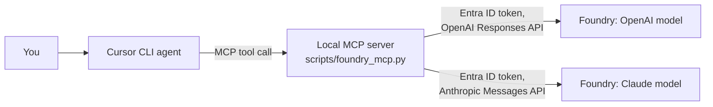

# Step-by-step: connect Cursor to Microsoft Foundry

This guide connects **Cursor CLI** to models you deploy in **Microsoft
Foundry**: an **OpenAI** model (GPT-6 Luna in the example) and an **Anthropic
Claude** model (Claude Haiku 5.5 in the example). Every command below was run
during the investigation. The outputs shown are from real runs.

> **Tested on:** Windows 11, PowerShell 7.6, Python 3.12, Azure CLI 2.93 and
> Cursor CLI `2026.11.13-eacade1` (17 November 2026). The scripts use
> cross-platform PowerShell 7 and should work on macOS and Linux, but those
> platforms were not tested.

## What you are building



A small local [MCP](https://modelcontextprotocol.io/) server gives Cursor two
tools:

| Tool | Calls | API used |
| --- | --- | --- |
| `foundry_openai` | Your OpenAI model deployment | OpenAI Responses API (`/openai/v1/`) |
| `foundry_claude` | Your Claude model deployment | Native Anthropic Messages API (`/anthropic`) |

The server signs in with your Azure CLI login (Microsoft Entra ID). No API key
is created, copied or stored, and the Azure credential never reaches Cursor.

> **Know the limits before you start.** Cursor's own agent model (for example
> `auto`) still runs on Cursor's service and is billed by Cursor. Your Foundry
> models do the work you delegate to them through the tools. As of November
> 2026, Cursor CLI and Cloud Agents have **no supported setting that sends
> their main model traffic to Foundry**. The [findings](../FINDINGS.md) explain
> why and show the evidence.

## Choose your path

| You want to... | Use | Status |
| --- | --- | --- |
| Use Foundry OpenAI **and** Claude models from Cursor CLI | This guide (MCP bridge) | **Verified end to end** |
| Use the same tools in the Cursor IDE agent | Same `.cursor/mcp.json` ([step 11](#11-use-it-in-your-own-project)) | Cursor documents that the CLI and IDE share MCP config; not tested here |
| Pick a Foundry **OpenAI-format** deployment as the chat model in the Cursor IDE | IDE **Azure OpenAI** API-key slot ([step 12](#12-cursor-ide-and-cloud-agents)) | Documented by Cursor; not tested here |
| Pick Foundry **Claude** as the main model in the IDE or CLI | No supported path found | Open feature requests ([F2], [F3]) |
| Use Foundry from Cursor **Cloud Agents** | Remote HTTP MCP service ([step 12](#12-cursor-ide-and-cloud-agents)) | Blueprint only; not tested |

[F2]: https://forum.cursor.com/t/allow-use-of-claude-models-through-azure-foundry/145774
[F3]: https://forum.cursor.com/t/request-to-override-anthropic-base-url/161445

## 1. Prerequisites

- An Azure subscription with a **Microsoft Foundry resource** and a
  **project**. Claude models need a paid subscription with a pay-as-you-go
  billing method and access to Azure Marketplace. Free trial, student,
  credit-only sponsored and CSP subscriptions are not supported for Claude.
  ([Microsoft Learn](https://learn.microsoft.com/azure/foundry/foundry-models/how-to/use-foundry-models-claude))
- [Azure CLI](https://learn.microsoft.com/cli/azure/install-azure-cli), signed in:

  ```powershell
  az login
  az account set --subscription <subscription-id>
  ```

- [PowerShell 7](https://learn.microsoft.com/powershell/scripting/install/installing-powershell)
  (`pwsh`), [Python 3.12+](https://www.python.org/downloads/) and Git.
- Cursor CLI, installed and signed in:

  ```bash
  # macOS, Linux, WSL
  curl https://cursor.com/install -fsS | bash
  ```

  ```powershell
  # Windows PowerShell
  irm 'https://cursor.com/install?win32=true' | iex
  ```

  ```powershell
  agent --version
  agent login
  ```

  A free Cursor account is enough for this guide; use `--model auto`.

## 2. Get the code and create your configuration

```powershell
git clone https://github.com/webmaxru/cursor-microsoft-foundry.git
cd cursor-microsoft-foundry
Copy-Item config/foundry.example.json config/foundry.json
```

Look up your values:

```powershell
az account show --query id -o tsv
az cognitiveservices account list --query "[?kind=='AIServices'].{name:name, resourceGroup:resourceGroup, location:location}" -o table
az cognitiveservices account project list -g <resource-group> -n <resource> --query "[].name" -o tsv
```

The last command prints `<resource>/<project>`. Use the part after the slash
as `project_name`.

Edit `config/foundry.json`:

| Key | What to put there |
| --- | --- |
| `subscription_id` | Your subscription ID |
| `resource_group` | Resource group of the Foundry resource |
| `account_name` | Foundry resource name |
| `project_name` | Foundry project name |
| `project_endpoint` | `https://<resource>.services.ai.azure.com/api/projects/<project>` |
| `base_url` | `https://<resource>.openai.azure.com/openai/v1/` (OpenAI v1 endpoint) |
| `deployment_name` | Name of your **OpenAI** model deployment |
| `model_name`, `model_version` | OpenAI model and version, for example `gpt-6-luna` and `2026-09-22` |
| `sku_name`, `capacity` | Used only by the deploy script, for example `DataZoneStandard` and `10` |
| `anthropic_base_url` | `https://<resource>.services.ai.azure.com/anthropic` |
| `claude_deployment_name` | Name of your **Claude** model deployment |
| `claude_model_name`, `claude_model_version` | Claude model and version, for example `claude-haiku-5-5` and `2` |

`config/foundry.json` contains no secrets, but it identifies your Azure
resources. It is listed in `.gitignore`, so it isn't committed.

## 3. Deploy an OpenAI model

See which OpenAI models your resource offers:

```powershell
az cognitiveservices account list-models -g <resource-group> -n <resource> --query "[?format=='OpenAI' && starts_with(name, 'gpt-6')].{name:name, version:version}" -o table
```

```text
Name           Version
-------------  ----------
gpt-6-astra    2026-09-03
gpt-6-luna     2026-09-22
gpt-6-sol      2026-09-22
gpt-6.1-sol    2026-09-29
gpt-6.1-terra  2026-10-26
```

**Option A: use the script.** It reads `config/foundry.json`, checks that the
model, version, SKU and quota are available, and then creates the deployment.
If a matching deployment already exists, it changes nothing. If a deployment
with that name exists with different settings, it stops without changing it.

```powershell
./scripts/Deploy-OpenAIModel.ps1
```

**Option B: use the Azure CLI directly.**

```powershell
az cognitiveservices account deployment create -g <resource-group> -n <resource> `
  --deployment-name cursor-poc-gpt-6-luna --model-name gpt-6-luna --model-version 2026-09-22 `
  --model-format OpenAI --sku-name DataZoneStandard --sku-capacity 10
```

**Option C: use the [Foundry portal](https://ai.azure.com):**
**Build > Catalog > Model Catalog**, choose the model, then **Deploy**.

A capacity of 10 gives roughly 10 requests and 10,000 tokens per minute. That
is a rate limit, **not a spending limit**. Standard deployments bill per token.

> The `foundry_openai` tool sends `reasoning: {"effort": "none"}`, which
> GPT-6 Luna accepts. If your OpenAI model rejects that value with HTTP 400,
> change `request_body` in `scripts/foundry_client.py`.

## 4. Deploy a Claude model

Claude models are deployed through Azure Marketplace. The portal is the
documented path:

1. Sign in to [Microsoft Foundry](https://ai.azure.com) with **New Foundry**
   turned on.
2. Go to **Build > Catalog > Model Catalog** and select a Claude model, for
   example **Claude Haiku 5.5**.
3. Select **Deploy > Custom settings**.
4. Read the Azure Marketplace terms, choose an industry, and select
   **Agree and Proceed**.
5. Pick the model version. **2: Hosted on Azure** is the default where both
   versions exist.
6. Keep or change the deployment name. Choose the region scope: **Global**,
   or **Data Zone** where available.
7. Select **Deploy** and wait for the status to show **Succeeded**.

You need **Contributor** or **Owner** on the resource group to deploy.
To deploy with Bicep or Terraform, see the
[Claude on Foundry starter kit](https://github.com/Azure-Samples/claude).

Put the deployment name in `claude_deployment_name`. To see which Claude
models and versions your resource offers:

```powershell
az cognitiveservices account list-models -g <resource-group> -n <resource> --query "[?format=='Anthropic'].{name:name, version:version}" -o table
```

> The PoC reused an existing Claude Haiku 5.5 deployment (version `2`, Global
> Standard), so the deployment steps above come from
> [Microsoft Learn](https://learn.microsoft.com/azure/foundry/foundry-models/how-to/use-foundry-models-claude)
> and were not repeated here.

## 5. Grant yourself inference access

Keyless (Entra ID) inference requires the **Cognitive Services User** role on
the Foundry resource. Owner and Contributor do **not** include inference
permission. **Cognitive Services OpenAI User** covers only OpenAI models, so
the Claude tool would fail with it.
([Microsoft Learn](https://learn.microsoft.com/azure/foundry/foundry-models/how-to/configure-entra-id))

```powershell
$me = az ad signed-in-user show --query id -o tsv
$scope = az cognitiveservices account show -g <resource-group> -n <resource> --query id -o tsv
az role assignment create --assignee-object-id $me --assignee-principal-type User --role "Cognitive Services User" --scope $scope
```

Role assignments can take **five minutes or more** to take effect. The test
account already had this role, so the assignment command was not run during
this investigation.

## 6. Install the bridge

```powershell
./scripts/Setup.ps1
```

This creates `.venv`, installs the pinned packages from
`requirements.lock.txt`, and writes `demo/.cursor/mcp.json` with absolute
paths for your machine:

```json
{
  "mcpServers": {
    "foundry-models": {
      "type": "stdio",
      "command": "/absolute/path/to/cursor-microsoft-foundry/.venv/bin/python",
      "args": ["/absolute/path/to/cursor-microsoft-foundry/scripts/foundry_mcp.py"]
    }
  }
}
```

Run it again whenever you move the folder.

## 7. Test Foundry without Cursor

Pick the virtual environment's Python for your OS:

```powershell
$py = if ($IsWindows) { './.venv/Scripts/python.exe' } else { './.venv/bin/python' }
```

Call each model directly, then through the MCP server:

```powershell
& $py scripts/smoke_test.py --transport direct --model openai
& $py scripts/smoke_test.py --transport direct --model claude
& $py scripts/smoke_test.py --transport mcp --model openai
& $py scripts/smoke_test.py --transport mcp --model claude
```

Each test sends a random arithmetic task with a one-time marker and checks
the exact answer. A pass prints a JSON record like this (shortened):

```json
{
  "test": "direct",
  "model": "openai",
  "passed": true,
  "expected": "NONCE_4e22c9113a906319:1602",
  "result": {
    "route": "Microsoft Foundry / Azure OpenAI Responses API",
    "authentication": "Microsoft Entra ID via Azure CLI",
    "deployment": "cursor-poc-gpt-6-luna",
    "response_id": "resp_09c284553f6f4302016afb967584f0819596652225004508af",
    "status": "completed",
    "text": "NONCE_4e22c9113a906319:1602"
  }
}
```

Fix any failure here before continuing; see [troubleshooting](#13-troubleshooting).

## 8. Connect Cursor CLI

Cursor reads `.cursor/mcp.json` from the folder it runs in. Approve only this
server, then check that Cursor can load its tools:

```powershell
cd demo
agent mcp enable foundry-models
agent mcp list
agent mcp list-tools foundry-models
```

```text
foundry-models: ready
Tools for foundry-models (2):
- foundry_claude (prompt, max_output_tokens)
- foundry_openai (prompt, max_output_tokens)
```

The demo's `.cursor/cli.json` allows only these two tools and denies shell,
file and web tools:

```json
{
  "permissions": {
    "allow": ["Mcp(foundry-models:foundry_openai)", "Mcp(foundry-models:foundry_claude)"],
    "deny": ["Shell(*)", "Read(**)", "Write(**)", "WebFetch(*)"]
  }
}
```

## 9. Ask Cursor to use your Foundry models

From the `demo` folder:

```powershell
agent --mode ask --model auto --print --trust "Call foundry_openai and foundry_claude, each with the prompt 'In one sentence, what is a Python list comprehension?'. For each tool, report its text, deployment and response_id. Do not read files or run shell commands."
```

Real output (exit code 0, about 30 seconds):

```text
**foundry_openai**
- **text:** A Python list comprehension is a concise way to create a list by transforming or filtering items from an iterable in a single expression.
- **deployment:** `cursor-poc-gpt-6-luna`
- **response_id:** `resp_0c6f4d57c8f858d0016afb99a9766c81958a84539c773a7180`

**foundry_claude**
- **text:** A Python list comprehension is a concise syntax for creating a new list by applying an expression to each item in an iterable, optionally filtering items with a condition, as in `[x * 2 for x in range(5) if x % 2 == 0]`.
- **deployment:** `claude-haiku-5-5`
- **response_id:** `msg_011Ch7X7ugJReAnRB6NoRKdT`
```

Both response IDs match records that the MCP server wrote to its local audit
log (`evidence/foundry-audit.jsonl`) when Azure responded, so they come from
real Azure calls, not from model-generated text. The published copies are
[`guide-prompt-output.txt`](../evidence-snapshot/guide-prompt-output.txt) and
[`foundry-audit.jsonl`](../evidence-snapshot/foundry-audit.jsonl). Your text
and IDs will differ. The `resp_` prefix comes from the OpenAI Responses API
and the `msg_` prefix from the Anthropic Messages API.

## 10. Run the full end-to-end check

From the repository root:

```powershell
cd ..
./scripts/Run-Poc.ps1
```

This runs all four smoke tests, approves and lists the MCP server, and then
runs `scripts/verify_cursor.py`. That script asks Cursor to call both tools
with fresh random tasks. It passes only if Cursor's answer contains the
correct results **and** the request hashes, response hashes and response IDs
match new audit records. The recorded run is in
[`cursor-mcp-e2e.json`](../evidence-snapshot/cursor-mcp-e2e.json).

## 11. Use it in your own project

1. Copy `demo/.cursor/mcp.json` to `<your-project>/.cursor/mcp.json`, or to
   `~/.cursor/mcp.json` to make the tools available in every project.
2. Allow the two tools in `<your-project>/.cursor/cli.json`:

   ```json
   {
     "permissions": {
       "allow": ["Mcp(foundry-models:foundry_openai)", "Mcp(foundry-models:foundry_claude)"]
     }
   }
   ```

   The demo's `deny` rules exist to isolate the experiment. In a real project,
   set shell and file permissions to suit your own workflow.
3. Approve the server from that project folder:

   ```powershell
   agent mcp enable foundry-models
   ```

4. Ask for the tool by name, for example: *"Ask foundry_claude to review the
   function below for edge cases"*.

Each tool call accepts up to 8,000 characters and 128 to 2,048 output tokens.
Text you send to a tool goes to **both** Foundry and Cursor, because Cursor's
agent writes the tool arguments and reads the results. Only the Azure
credential stays on your machine.

**Cursor IDE.** Cursor documents one MCP configuration shared by the CLI and
the editor, so the same `.cursor/mcp.json` should make the tools available to
the IDE agent. The IDE was not tested in this investigation.

## 12. Cursor IDE and Cloud Agents

**IDE Azure OpenAI API key (OpenAI-format models only).** Cursor's
[Bring your own API key](https://cursor.com/help/models-and-usage/api-keys)
page lists an **Azure OpenAI** provider under **Cursor Settings > Models**.
Cursor staff say it works with OpenAI-format Foundry deployments but not with
Claude ([forum](https://forum.cursor.com/t/support-for-azure-ai-foundry/162862/10)).
Things to know before you use it:

- It needs a resource **API key**, not Entra ID.
- Every request, including your key, goes through Cursor's backend.
- Cursor's Zero Data Retention policy does not apply.
- It works only for chat models; Tab completion keeps using Cursor's models.
- Teams and Enterprise plans pay the Cursor Token Rate.

This path was researched, not tested here.

**Cloud Agents.** Cursor Cloud Agents run in remote VMs, so they can't reach
a stdio server on your laptop. The current Cloud Agents API accepts MCP server
definitions over HTTP or stdio. A working setup would need an authenticated
HTTP MCP service hosting the same two tools, for example in Azure with a
managed identity. It also needs a Cursor plan that includes Cloud Agents.
[`config/cloud-agent.request.example.json`](../config/cloud-agent.request.example.json)
shows the request shape. It is a **blueprint, not a tested deployment**. See
[Findings, section 6](../FINDINGS.md#6-cursor-cloud-agents).

## 13. Troubleshooting

| Symptom | Cause and fix |
| --- | --- |
| `FileNotFoundError: Missing ...config/foundry.json` | Copy `config/foundry.example.json` to `config/foundry.json` ([step 2](#2-get-the-code-and-create-your-configuration)). |
| `ValueError: base_url must be ...` | `base_url` must be exactly `https://<account_name>.openai.azure.com/openai/v1/`. The scripts assume the resource's custom subdomain equals its name, which is the default for Foundry resources. |
| HTTP 401 or 403 | Assign **Cognitive Services User** ([step 5](#5-grant-yourself-inference-access)) and wait. Check that `az account show` lists the subscription in your config. |
| HTTP 404 `DeploymentNotFound` | The deployment name in the config doesn't match the deployment. |
| HTTP 400 about `reasoning.effort` | The OpenAI model doesn't accept `none` (see [step 3](#3-deploy-an-openai-model)). Claude rejects `none` on the Responses API; the Claude tool uses native Messages and isn't affected. |
| HTTP 404 `api_not_supported` for Claude | The Claude deployment returned 404 on both Chat Completions routes. Use Anthropic Messages, as the tool does. |
| HTTP 429 | Your deployment capacity is low. Run tests one at a time or raise capacity. |
| `Model unavailable on Free` from Cursor | Use `--model auto`. |
| `agent mcp list-tools` can't find `foundry-models` | Run it from the folder that contains `.cursor/mcp.json`. |
| Cursor asks for approval again | Changing `mcp.json` resets approval. Run `agent mcp enable foundry-models` again. |
| Windows: "The system cannot find the path specified" | Run `./scripts/Setup.ps1` again to rewrite absolute paths. |

## 14. Clean up

Delete only the OpenAI deployment you created for this guide:

```powershell
az cognitiveservices account deployment delete -g <resource-group> -n <resource> --deployment-name <openai-deployment-name>
```

Delete the Claude deployment the same way if you created it only for this
guide. Then disconnect Cursor from the server:

```powershell
cd demo
agent mcp disable foundry-models
```

Nothing else runs in the background: the MCP server starts and stops with
each Cursor session.
