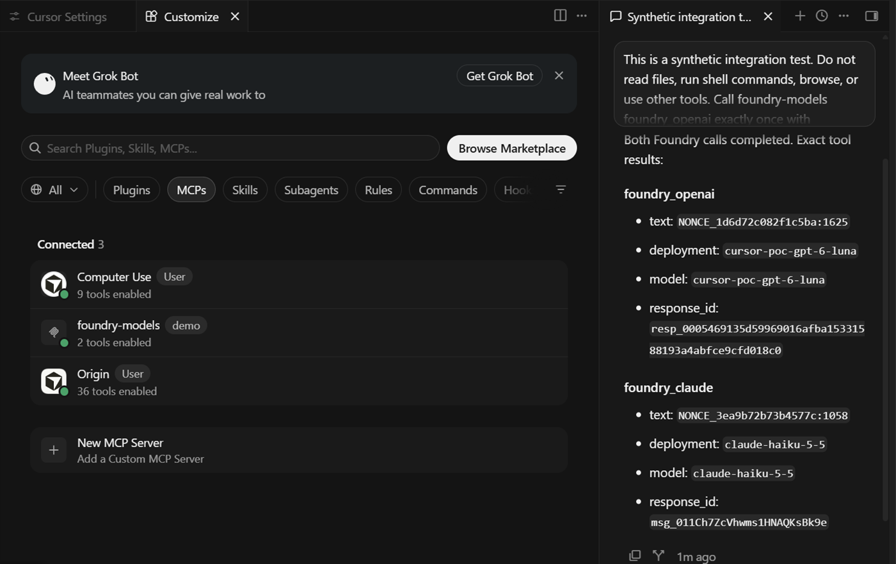
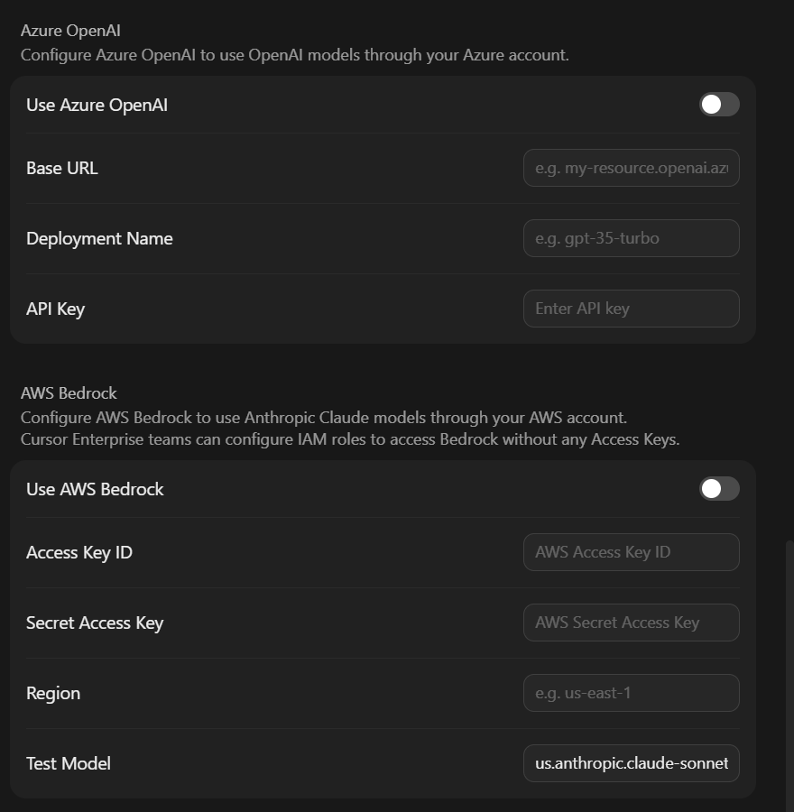
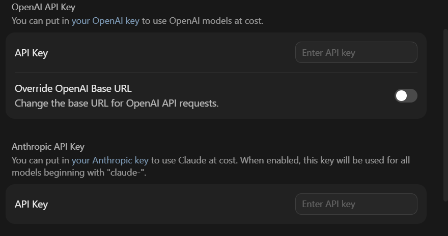

# Cursor IDE with Microsoft Foundry

**Verdict:** the Cursor IDE Agent can call your Foundry OpenAI and Claude
deployments as **MCP tools**. This was **verified end to end** in Cursor IDE
3.30.14. The IDE also has an **Azure OpenAI** API-key slot that can make a
Foundry OpenAI-format deployment a chat model. Cursor staff confirm it, but it
was not tested here with a key. **No IDE setting sends Claude traffic to
Foundry.**

| Path | What you get | Models | Status |
| --- | --- | --- | --- |
| [A. MCP tools](#path-a-foundry-models-as-mcp-tools) | The Agent calls Foundry deployments as tools | OpenAI and Claude | **Verified** |
| [B. Azure OpenAI slot](#path-b-azure-openai-api-key-slot) | A Foundry deployment appears as a chat model | OpenAI format only | Confirmed by Cursor staff; fields captured; not tested with a key |
| [C. OpenAI base URL override](#path-c-openai-key-with-a-base-url-override) | Foundry `/openai/v1/` as a custom OpenAI endpoint | OpenAI format only | Community guides; global side effects; not tested |
| [Foundry Claude as the chat model](#claude-from-foundry) | | | No path: the Anthropic key slot has no base URL |

> **Tested with:** Cursor IDE 3.30.14 on Windows 11, Cursor Free plan
> (17 November 2026). On this plan the Agent model picker allowed only
> Grok 4.7.

## Before you start

- Install the Cursor IDE from [cursor.com/download](https://cursor.com/download)
  and sign in.
- **Path A:** complete [Foundry setup](setup.md) steps 1 to 7. A free Cursor
  account is enough.
- **Paths B and C:** complete Foundry setup steps 1 to 3. You also need an API
  key for the Foundry resource, so key authentication must be enabled on it.
  Read [the side effects](#pitfalls-when-you-turn-on-an-api-key) first.

## Path A: Foundry models as MCP tools

The IDE reads the same `.cursor/mcp.json` file as the
[CLI](cli.md). `Setup.ps1` wrote one with absolute paths to the `demo` folder.

1. **Open the folder.** Use **File > Open Folder** and choose `demo` in your
   clone. To use the tools in your own project, copy `demo/.cursor/mcp.json`
   to `<your-project>/.cursor/mcp.json`, or to `~/.cursor/mcp.json` for every
   project.
2. **Turn the server on.** Open **Cursor Settings** (gear icon, top right),
   then select **Customize** in the settings sidebar. In the **Customize** tab,
   filter by **MCPs**. `foundry-models` appears with a badge showing the
   project folder (`demo`).
   **Project MCP servers start turned off.** Turn it on. After a few seconds
   the status dot turns green and the entry shows **2 tools enabled**.
3. **Ask the Agent.** Start a new Agent chat and name the tools:

   ```text
   Call foundry_openai and foundry_claude, each with the prompt "In one sentence, what is a Python list comprehension?". For each tool, report its text, deployment and response_id.
   ```

   In the recorded run the Agent first searched the tool schemas
   ("Explored 1 search, 2 tools") and then called both tools. No approval
   prompt appeared. Depending on your auto-run settings, Cursor may ask you to
   approve each call.



### Prove it with a fresh challenge

`verify_ide.py` checks that the IDE really reached Azure. It works in two
phases because the IDE has no command-line mode:

```powershell
$py = if ($IsWindows) { './.venv/Scripts/python.exe' } else { './.venv/bin/python' }
& $py scripts/verify_ide.py prepare
```

`prepare` saves a random arithmetic challenge with one-time markers to
`evidence/ide-challenge.json` and prints a prompt. Paste that prompt into a
new Agent chat in the `demo` folder. When the Agent finishes, copy the chat
into `evidence/ide-transcript.txt`, then run:

```powershell
& $py scripts/verify_ide.py check evidence/ide-transcript.txt
```

`check` passes only if the transcript contains both correct answers and the
response IDs of new audit records whose answers hash to the expected text. It
writes `evidence/ide-mcp-e2e.json` and exits with a non-zero code on failure.

Recorded run ([`ide-mcp-e2e.json`](../evidence-snapshot/ide-mcp-e2e.json),
[`ide-transcript.txt`](../evidence-snapshot/ide-transcript.txt)):

| Tool | Expected and returned | Response ID | Azure request ID | Tokens in / out |
| --- | --- | --- | --- | --- |
| `foundry_openai` (GPT-6 Luna) | `NONCE_1d6d72c082f1c5ba:1625` | `resp_0005469135d59969016afba15331588193a4abfce9cfd018c0` | `cff94086-7086-4bd8-84c6-73fe5beed153` | 40 / 22 |
| `foundry_claude` (Claude Haiku 5.5) | `NONCE_3ea9b72b73b4577c:1058` | `msg_011Ch7ZcVhwms1HNAQKsBk9e` | `req_011Ch7ZcUwYqzm3QvWPTp9Hr` | 53 / 22 |

The Agent itself ran on Grok 4.7 through Cursor. Only the two tool calls were
processed and billed by Foundry. Text you send to a tool goes to both Foundry
and Cursor; the Azure credential stays on your machine.

## Path B: Azure OpenAI API-key slot

**Cursor Settings > Models**, then expand **API Keys** and scroll to
**Azure OpenAI**:



| Field | What to enter for Foundry |
| --- | --- |
| **Use Azure OpenAI** | On |
| **Base URL** | `<resource>.openai.azure.com`, the format the placeholder shows. Cursor staff say `*.cognitiveservices.azure.com` endpoints work too. |
| **Deployment Name** | Your OpenAI deployment, for example `cursor-poc-gpt-6-luna` |
| **API Key** | A key of the Foundry resource (portal: **Keys and Endpoint**) |

**What is confirmed.** On 10 November 2026 Cursor staff said that Foundry
OpenAI deployments should work through this slot, that there is no dedicated
Foundry integration yet, and that there is no timeline for one [F8]. Claude
deployments don't work here because they use a different API format [F1].

**What the route probe shows.** Cursor doesn't document which Azure API this
slot calls, and forum reports show it differs by model.
`scripts/probe_openai_routes.py` called the Luna deployment on each candidate
route with Entra authentication
([`openai-api-routes.json`](../evidence-snapshot/openai-api-routes.json)):

| Route | Result |
| --- | --- |
| Current `/openai/v1/chat/completions` | 200 |
| Current `/openai/v1/chat/completions` with `reasoning_effort` | 200 |
| Current `/openai/v1/chat/completions` with a Responses-style `reasoning` object | **400** `unknown_parameter`: "Unknown parameter: 'reasoning'." |
| Legacy `/openai/deployments/<name>/chat/completions?api-version=...` | 200 |
| Current `/openai/v1/responses` | 200 |

That 400 is the error users report for GPT-6 Astra in this slot. Cursor staff
explained that, for some models, Cursor sends a reasoning setting that only
the Responses API accepts to the Chat Completions endpoint. GPT-5.6
deployments go through the Responses API instead. It is a known issue [F9].
Another thread reports `response.failed` errors from the Agent with Azure
deployments of GPT-5.4 and GPT-5.6 [F10]. **Test your model before relying on
it.**

**Why it wasn't tested here.** This investigation used keyless Entra
authentication only. The slot needs a resource API key, and Cursor sends that
key through its backend with each request. Plan eligibility for your own keys
also varies [F22]. The settings were inspected and captured but no key was
entered.

## Path C: OpenAI key with a base URL override

Under **API Keys**, the **OpenAI API Key** section has an
**Override OpenAI Base URL** toggle. The **Anthropic API Key** section below it
has no base URL option:



Community guides use this for OpenAI-compatible endpoints [F21]. For Foundry
it would mean the base URL `https://<resource>.openai.azure.com/openai/v1`,
the resource key as the OpenAI key, and a custom model named after your
deployment. The probe above shows that the current v1 Chat Completions route
answers for Luna. **The override is global**, which causes most of the
reported problems:

- It applies to every model that isn't Claude or Gemini, including Cursor's
  own Composer and Grok models, which then fail with "This model does not
  support custom API keys" [F18].
- Users report that no models work while the override is on [F19], and there
  is no per-model base URL yet [F20].

This path was not tested here. Prefer path B for Foundry OpenAI models.

## Claude from Foundry

- The **Anthropic API Key** is "used for all models beginning with
  'claude-'" and has **no base URL override** (screenshot above). Requests to
  add one remain open [F3].
- The **AWS Bedrock** section (bottom of the path B screenshot) reaches Claude
  on AWS only.
- Requests for native Foundry Claude support date back to December 2025 [F2].
  A community proxy that translates OpenAI requests to Anthropic exists, but
  its author used it mainly with Ctrl+K, not the Agent [F6]. Gateway users
  report that Cursor's built-in model IDs can bypass an override [F7].

**Use path A for Foundry Claude.** The `foundry_claude` tool calls the native
Anthropic Messages API with Entra authentication.

## Pitfalls when you turn on an API key

Each row comes from Cursor staff replies on the forum.

| What happens | Why | Sources |
| --- | --- | --- |
| Models other than Auto, Composer and Cursor's Grok start failing | When any personal key toggle is on, those other models go through your key configuration | [F11] |
| Every model fails with `resource_exhausted` | **Use Azure OpenAI** was on with empty fields | [F12] |
| Cursor's Grok 4.6 fails behind a Cloudflare block | Grok 4.6 runs only on Cursor's infrastructure; turn off personal keys and the override | [F15], [F16] |
| Claude or GPT models fail with a `tool_use` error | Remove the OpenAI base URL override or Azure key while using Anthropic models | [F17] |
| AWS Bedrock models fail with "Unknown parameter: 'system'" or invalid names | With both on, Azure settings win over Bedrock and Azure rejects the Claude-format request | [F13], [F14] |
| Tab completion doesn't use your model | Your own keys apply to chat models only; Tab always uses Cursor's models | [F22], [C11] |

**Privacy and billing.** Cursor's documentation says requests made with your
key still pass through Cursor's backend to build the prompt. Zero Data
Retention doesn't apply, and Teams and Enterprise plans pay Cursor's token
rate on top [C11]. Path A keeps the Azure credential local, but the tool
arguments and results still pass through Cursor.

## Troubleshooting

Problems with Azure, roles or deployments are covered in
[Foundry setup troubleshooting](setup.md#8-troubleshooting).

| Symptom | Cause and fix |
| --- | --- |
| `foundry-models` is missing in **Customize** | Open the folder that contains `.cursor/mcp.json` (`demo`), or copy the file to `~/.cursor/mcp.json`. |
| The server is listed but has no tools | It is turned off; project servers start off. Turn it on and wait for the green dot. |
| Red status or "The system cannot find the path specified" | Run `./scripts/Setup.ps1` again to rewrite absolute paths, then check with `smoke_test.py --transport mcp`. |
| The Agent answers without calling the tools | Name `foundry_openai` or `foundry_claude` in the prompt. |
| A model shows a lock or "Upgrade" | Your plan doesn't include it. On the Free plan used here only Grok 4.7 was available. The tools work with any Agent model. |
| Every model fails after you set a key | See [pitfalls](#pitfalls-when-you-turn-on-an-api-key). Turn off **Use Azure OpenAI** and **Override OpenAI Base URL**, and clear empty fields. |
| `Unknown parameter: 'reasoning'` with the Azure slot | Known issue for some models [F9]. Try a model that Cursor sends through the Responses API, or use path A. |

## Clean up

1. **Customize > MCPs > foundry-models:** turn it off. The test IDE was left
   with it on after the recorded run.
2. **Cursor Settings > Models > API Keys:** turn off any key toggles you
   turned on, and clear their fields.
3. [Delete the deployments](setup.md#9-clean-up) you no longer need.

---

Source keys such as [F8] and [C11] refer to [Sources](../SOURCES.md).
