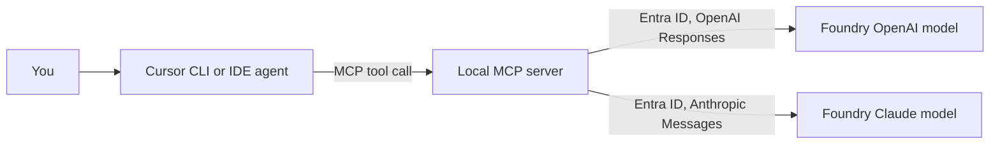

# Use Microsoft Foundry models from Cursor

Connect Cursor to **OpenAI** and **Anthropic Claude** models deployed in
**Microsoft Foundry**, with keyless Microsoft Entra ID authentication. This
site has tested proofs of concept, a setup guide for each Cursor surface, and
a source-cited investigation of what Cursor supports as of November 2026.

## Choose your Cursor surface

{.surfaces}
- [Cursor CLI](cli.md){.card-link} [Verified]{.status .status-verified}

  The `agent` command in your terminal. Foundry OpenAI and Claude models work
  as MCP tools. `--endpoint` and provider environment variables don't reach
  Foundry.

- [Cursor IDE](ide.md){.card-link} [Partly verified]{.status .status-partial}

  The Agent panel in the editor. The same MCP tools work. The Azure OpenAI key
  slot can make a Foundry OpenAI deployment the chat model; Claude has no
  path.

- [Cloud Agents](cloud.md){.card-link} [Blueprint]{.status .status-blueprint}

  Agents in Cursor-hosted VMs. There's no provider setting, but an HTTP MCP
  service in Azure could reach Foundry. Not run: it needs a paid plan.

## For every surface

{.general-links}
- [Foundry setup](setup.md): deploy an OpenAI and a Claude model, grant
  access, install the bridge and test it without Cursor.
- [Findings](../FINDINGS.md): results by surface, API formats, forum
  threads, privacy, billing and recommendations.
- [Scripts and config](scripts.md): what each script does and whether it
  calls Azure.
- [Evidence](evidence.md): redacted records from the live runs.
- [Sources](../SOURCES.md): Cursor documentation, forum threads, Microsoft
  Learn and SDK references.

## The short answer

- **Cursor can use your Foundry models as tools, in the CLI and the IDE.** A
  small local MCP server exposes `foundry_openai` (GPT-6 Luna through the
  OpenAI Responses API) and `foundry_claude` (Claude Haiku 5.5 through the
  Anthropic Messages API). Both were verified end to end.
- **Only the IDE can make a Foundry model Cursor's own chat model**, through
  its Azure OpenAI API-key slot, and only for OpenAI-format deployments.
  Cursor staff confirm it works; it wasn't tested here with a key.
- **The CLI and Cloud Agents have no such setting.** The CLI's `--endpoint`
  flag points at Cursor's own service.
- **Claude on Foundry as Cursor's chat model** is an open feature request on
  every surface.

## How the working setup fits together

Cursor's agent decides when to call a tool. The local MCP server signs in with
your Azure CLI login and calls the Foundry deployment you configured. The
Azure credential never leaves your machine. Prompts and answers that pass
through the tools are visible to both Cursor and Foundry.

## Proof from the live runs

Verification scripts asked Cursor to call both tools with fresh random
arithmetic tasks. Each run passed only after Cursor's answers matched new
audit records written when Azure responded.

| Surface | Tool | Foundry deployment | Azure response ID | Tokens (in / out) |
| --- | --- | --- | --- | --- |
| CLI | `foundry_openai` | `cursor-poc-gpt-6-luna` (GPT-6 Luna) | `resp_08c09992e1416134016afb96dcb23481979dd02741f3a63f86` | 40 / 22 |
| CLI | `foundry_claude` | `claude-haiku-5-5` (Claude Haiku 5.5) | `msg_011Ch7WD7WDz7GtAkBPwrgc7` | 53 / 22 |
| IDE | `foundry_openai` | `cursor-poc-gpt-6-luna` (GPT-6 Luna) | `resp_0005469135d59969016afba15331588193a4abfce9cfd018c0` | 40 / 22 |
| IDE | `foundry_claude` | `claude-haiku-5-5` (Claude Haiku 5.5) | `msg_011Ch7ZcVhwms1HNAQKsBk9e` | 53 / 22 |

See the [evidence index](evidence.md) for every recorded result. All code is
on [GitHub](https://github.com/webmaxru/cursor-microsoft-foundry) under the
MIT license.
