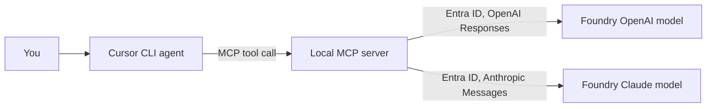

# Use Microsoft Foundry models from Cursor

Connect Cursor CLI to **OpenAI** and **Anthropic Claude** models deployed in
**Microsoft Foundry**, using keyless Microsoft Entra ID authentication.
This site has a tested proof of concept, a step-by-step guide and a
source-cited investigation of what Cursor supports as of November 2026.

[Start the guide](guide.md){.button} [Read the findings](../FINDINGS.md){.button .secondary}

## The short answer

- **Cursor CLI can use your Foundry models as tools.** A small local MCP server
  exposes `foundry_openai` (GPT-6 Luna through the OpenAI Responses API) and
  `foundry_claude` (Claude Haiku 5.5 through the Anthropic Messages API).
  This was verified end to end with the real Cursor CLI.
- **Cursor's main agent model can't be pointed at Foundry from the CLI or Cloud
  Agents.** No supported setting was found. The CLI's `--endpoint` flag points
  at Cursor's own service.
- **The Cursor IDE has an Azure OpenAI API-key slot** that Cursor staff say
  works for OpenAI-format Foundry deployments, but not for Claude.
- **Claude on Foundry as Cursor's main model** is an open feature request.

## How the working setup fits together

Cursor's agent decides when to call a tool. The local MCP server signs in with
your Azure CLI login and calls the Foundry deployment you configured. The
Azure credential never leaves your machine. Prompts and answers that pass
through the tools are visible to both Cursor and Foundry.

## Which path fits your case

| You want to... | Path | Status |
| --- | --- | --- |
| Use Foundry OpenAI and Claude models from Cursor CLI | [MCP bridge](guide.md) | **Verified** |
| Use the same tools in the Cursor IDE agent | Same `.cursor/mcp.json` | Documented by Cursor; not tested |
| Use a Foundry OpenAI-format deployment as the IDE chat model | IDE Azure OpenAI API-key slot | Documented by Cursor; not tested |
| Use Foundry Claude as Cursor's main model | None today | [Feature request](https://forum.cursor.com/t/allow-use-of-claude-models-through-azure-foundry/145774) |
| Use Foundry from Cursor Cloud Agents | Remote HTTP MCP service | Blueprint; not tested |

## Proof from the live run

The verification script asked Cursor CLI to call both tools with fresh random
arithmetic tasks. It passed only after matching Cursor's answer to new audit
records written when Azure responded.

| Tool | Foundry deployment | API | Azure response ID | Tokens (in / out) |
| --- | --- | --- | --- | --- |
| `foundry_openai` | `cursor-poc-gpt-6-luna` (GPT-6 Luna) | OpenAI Responses | `resp_08c09992e1416134016afb96dcb23481979dd02741f3a63f86` | 40 / 22 |
| `foundry_claude` | `claude-haiku-5-5` (Claude Haiku 5.5) | Anthropic Messages | `msg_011Ch7WD7WDz7GtAkBPwrgc7` | 53 / 22 |

See the [evidence index](evidence.md) for every recorded result.

## What's on this site

- **[Step-by-step guide](guide.md):** deploy the models, grant access, connect
  Cursor and run your first prompt.
- **[Findings](../FINDINGS.md):** Cursor CLI, IDE and Cloud Agents behavior,
  API formats for Claude on Foundry, privacy, billing and recommendations.
- **[Scripts and config](scripts.md):** what each script does and whether it
  calls Azure.
- **[Evidence](evidence.md):** redacted results from the live runs.
- **[Sources](../SOURCES.md):** Cursor documentation, forum threads, Microsoft
  Learn and SDK references.

All code is on [GitHub](https://github.com/webmaxru/cursor-microsoft-foundry)
under the MIT license.
