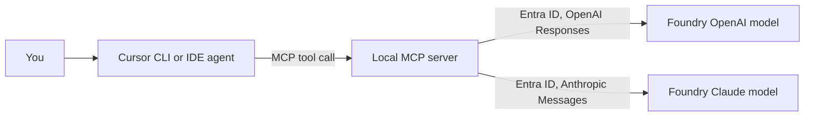

# Use Microsoft Foundry models from Cursor

Can Cursor run on **Microsoft Foundry** the way Claude Code can? This site
tested all three Cursor surfaces with **OpenAI GPT-6 Luna** and **Anthropic
Claude Haiku 5.5** deployed in Foundry. It shows what a full switch needs,
where Cursor allows one, what each option costs you, and the fallback where
none exists. Status as of November 2026.

## Choose your Cursor surface

{.surfaces}
- [Cursor IDE](ide.md){.card-link} [Switch for chat and Agent]{.status .status-verified}

  Your own key in the Azure OpenAI slot sends chat and Agent requests to a
  Foundry deployment, through Cursor's servers, on a paid plan. Verified with
  a real key: `gpt-4.1` answered with tool calls, every request `200` in
  Foundry. GPT-6 Luna and Claude ran through a translating proxy behind a
  public tunnel. Tab, Auto and Composer stay on Cursor.

- [Cursor CLI](cli.md){.card-link} [No switch]{.status .status-none}

  The `agent` command in your terminal. `--endpoint` is Cursor's own service
  and `--model` takes only Cursor's catalog. The earlier MCP connectivity
  proof passed; the development study exposes a native-discovery failure
  and tests an explicit shell-client alternative.

- [Cloud Agents](cloud.md){.card-link} [No switch]{.status .status-none}

  Agents in Cursor-hosted VMs. Cursor says own keys are not supported by
  design, and a custom model gave "Model Not Available" on Premium. An HTTP
  MCP service in Azure could serve Foundry as tools; not run.

## The short answer

- **There is no full switch like Claude Code's.** Claude Code sends its own
  model calls straight to Foundry. Cursor sends model calls from its servers.
- **The IDE has a real switch for chat and the Agent.** The Azure OpenAI key
  slot, pointed at `https://<resource>.openai.azure.com`, makes a Foundry
  OpenAI deployment the chat and Agent model. With a real key on Premium, the
  Agent ran on `gpt-4.1` with tool calls and Foundry answered `200` to every
  request. Tab, Auto and Cursor's own models stay on Cursor
  ([is it broken?](ide.md#is-the-documented-option-broken)).
- **GPT-6 Luna and Claude need a proxy.** Foundry refuses Luna with Cursor's
  tools on Chat Completions (`400`), and serves Claude only on the Messages
  and Responses APIs. The
  [translating proxy](ide.md#can-a-proxy-bring-claude-to-the-ide) built here,
  behind a public tunnel, ran the Agent on both from the Azure slot and from
  the OpenAI override.
- **The CLI and Cloud Agents have no switch.** On Premium they refused custom
  models. There, the fallback is MCP: Cursor's model stays the agent and calls
  Foundry deployments as tools.

> **Correction, 17 November 2026.** Earlier versions said the IDE slot failed
> with a real key and that Cursor refused gateways in the IDE. My UI automation
> had never saved Cursor's settings
> ([what went wrong](ide.md#correction-what-went-wrong-in-the-first-tests)).

## How Cursor compares with Claude Code

| | Claude Code [A3] | Cursor IDE | Cursor CLI | Cloud Agents |
| --- | --- | --- | --- | --- |
| Full switch to Foundry | **Yes**: `CLAUDE_CODE_USE_FOUNDRY=1` | **For chat and the Agent**: the Azure slot with your own key; verified with a real key | **No** | **No**, by design |
| Model calls come from | Your machine | Cursor's servers | Cursor | Cursor |
| Sign-in | Key, Entra ID or token | Key only | Not applicable | Not applicable |
| Claude on Foundry | Yes | Through a proxy you run | No | No |
| OpenAI on Foundry | Not applicable: it runs Claude models | Yes, one deployment at a time; reasoning models through a proxy | No | No |
| Fallback | None needed | MCP tools | MCP tools | HTTP MCP tools |

[Read the full comparison](fullswitch.md), including what the community says
and every disadvantage of the IDE route.

## For every surface

{.general-links}
- [Full switch](fullswitch.md): can Cursor fully switch to Foundry, with the
  Claude Code comparison and community evidence.
- [MCP for real development](development.md): a greenfield application,
  Cursor-versus-Foundry token accounting and a fresh-session context handoff.
- [Foundry setup](setup.md): deploy an OpenAI and a Claude model, grant
  access, install the bridge and test it without Cursor.
- [Findings](../FINDINGS.md): results by surface, API formats, forum
  threads, privacy, billing and recommendations.
- [Scripts and config](scripts.md): what each script does and whether it
  calls Azure.
- [Evidence](evidence.md): redacted records from the live runs.
- [Sources](../SOURCES.md): Cursor documentation, forum threads, Microsoft
  Learn and SDK references.

## How the MCP fallback works

This is **not a switch**: Cursor's model still runs the agent. It decides when
to call a tool. The local MCP server signs in with your Azure CLI login and
calls the Foundry deployment you configured, so the Azure credential never
leaves your machine. Prompts and answers that pass through the tools are
visible to both Cursor and Foundry.

Beyond connectivity: [does this work for real development?](development.md)
The separate study compares a Cursor-only workflow with Foundry-heavy
implementation and review on the same small application. Both completed the
planned features, but the shell-MCP workflow took **24.9 versus 13.0 minutes**
and used **52.4% more Cursor output tokens**. Additional checks found validation
and encoding gaps: useful bounded assistance, not a full switch or a savings claim.

## Proof from the live runs

Verification scripts asked Cursor to call both tools with fresh random
arithmetic tasks. Each run passed only after Cursor's answers matched new
audit records written when Azure responded.

These are historical arithmetic results, not a production-readiness claim.
Native tool dispatch failed in the later development sessions even though
tool listing succeeded. The [development study](development.md) distinguishes
that failure from the shell-invoked MCP client used for the coding comparison.

| Surface | Tool | Foundry deployment | Azure response ID | Tokens (in / out) |
| --- | --- | --- | --- | --- |
| CLI | `foundry_openai` | `cursor-poc-gpt-6-luna` (GPT-6 Luna) | `resp_08c09992e1416134016afb96dcb23481979dd02741f3a63f86` | 40 / 22 |
| CLI | `foundry_claude` | `claude-haiku-5-5` (Claude Haiku 5.5) | `msg_011Ch7WD7WDz7GtAkBPwrgc7` | 53 / 22 |
| IDE | `foundry_openai` | `cursor-poc-gpt-6-luna` (GPT-6 Luna) | `resp_0005469135d59969016afba15331588193a4abfce9cfd018c0` | 40 / 22 |
| IDE | `foundry_claude` | `claude-haiku-5-5` (Claude Haiku 5.5) | `msg_011Ch7ZcVhwms1HNAQKsBk9e` | 53 / 22 |

The switch was tested on a Premium plan. Foundry accepted 12 of 12 probes
with a resource API key, a second key probe confirmed that Claude has no Chat
Completions route while GPT has, and a LiteLLM gateway passed 15 of 15
Cursor-shaped cases for both models. The CLI said "Cannot use this model" and
Cloud Agents said "Model Not Available" for custom models. In the IDE, with
the resource's real key in the Azure slot, Foundry answered `200` to the
Agent's requests on a `gpt-4.1` deployment, including tool calls, on a Foundry
resource and on a classic Azure OpenAI resource
([real-key round](ide.md#what-happened-with-a-real-key)). A translating proxy
behind a public tunnel logged 14 requests from Cursor's backend and ran the
Agent on Claude Haiku 5.5 and GPT-6 Luna, from the Azure slot and from the
OpenAI override.

See the [evidence index](evidence.md) for every recorded result. All code is
on [GitHub](https://github.com/webmaxru/cursor-microsoft-foundry) under the
MIT license.
