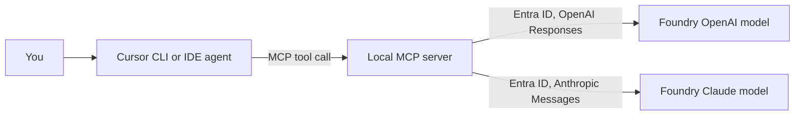

# Use Microsoft Foundry models from Cursor

Can Cursor run on **Microsoft Foundry** the way Claude Code can? This site
tested all three Cursor surfaces with **OpenAI GPT-6 Luna** and **Anthropic
Claude Haiku 5.5** deployed in Foundry. It shows what a full switch needs,
where Cursor allows one, what each option costs you, and the fallback where
none exists. Status as of November 2026.

## Choose your Cursor surface

{.surfaces}
- [Cursor IDE](ide.md){.card-link} [Partial switch]{.status .status-partial}

  Chat and Agent models can run on a Foundry OpenAI deployment through your
  own API key, but only through Cursor's servers, and only on a paid plan.
  Claude needs a gateway. The Foundry side is verified; Cursor's own request
  wasn't observed on the Free plan.

- [Cursor CLI](cli.md){.card-link} [No switch]{.status .status-none}

  The `agent` command in your terminal. `--endpoint` is Cursor's own service
  and `--model` takes only Cursor's catalog. Foundry models work as MCP tools,
  verified end to end.

- [Cloud Agents](cloud.md){.card-link} [No switch]{.status .status-none}

  Agents in Cursor-hosted VMs. Cursor says own keys are not supported by
  design. An HTTP MCP service in Azure could serve Foundry as tools. Not run:
  it needs a paid plan.

## The short answer

- **There is no full switch like Claude Code's.** Claude Code sends its own
  model calls straight to Foundry. Cursor sends model calls from its servers.
- **The IDE comes closest.** The Azure OpenAI key slot, or the OpenAI key with
  a base URL override, can make a Foundry OpenAI deployment the chat model.
  Tab, Auto and Cursor's own models stay on Cursor.
- **Claude on Foundry isn't a direct option.** Cursor's Anthropic slot has no
  base URL and Foundry rejects Claude on Chat Completions. A translating
  gateway works locally but wasn't tested through Cursor.
- **The CLI and Cloud Agents have no switch.** Where none exists, the fallback
  is MCP: Cursor's model stays the agent and calls Foundry deployments as
  tools.

## How Cursor compares with Claude Code

| | Claude Code [A3] | Cursor IDE | Cursor CLI | Cloud Agents |
| --- | --- | --- | --- | --- |
| Full switch to Foundry | **Yes**: `CLAUDE_CODE_USE_FOUNDRY=1` | **Partial**: chat models, your own key | **No** | **No**, by design |
| Model calls come from | Your machine | Cursor's servers | Cursor | Cursor |
| Sign-in | Key, Entra ID or token | Key only | Not applicable | Not applicable |
| Claude on Foundry | Yes | Gateway needed | No | No |
| OpenAI on Foundry | Not applicable: it runs Claude models | Yes, OpenAI format | No | No |
| Fallback | None needed | MCP tools | MCP tools | HTTP MCP tools |

[Read the full comparison](fullswitch.md), including what the community says
and every disadvantage of the IDE route.

## For every surface

{.general-links}
- [Full switch](fullswitch.md): can Cursor fully switch to Foundry, with the
  Claude Code comparison and community evidence.
- [Foundry setup](setup.md): deploy an OpenAI and a Claude model, grant
  access, install the bridge and test it without Cursor.
- [Findings](../FINDINGS.md): results by surface, API formats, forum
  threads, privacy, billing and recommendations.
- [Scripts and config](scripts.md): what each script does and whether it
  calls Azure.
- [Evidence](evidence.md): redacted records from the live runs.
- [Sources](../SOURCES.md): Cursor documentation, forum threads, Microsoft
  Learn and SDK references.

## How the MCP fallback works

This is **not a switch**: Cursor's model still runs the agent. It decides when
to call a tool. The local MCP server signs in with your Azure CLI login and
calls the Foundry deployment you configured, so the Azure credential never
leaves your machine. Prompts and answers that pass through the tools are
visible to both Cursor and Foundry.

## Proof from the live runs

Verification scripts asked Cursor to call both tools with fresh random
arithmetic tasks. Each run passed only after Cursor's answers matched new
audit records written when Azure responded.

| Surface | Tool | Foundry deployment | Azure response ID | Tokens (in / out) |
| --- | --- | --- | --- | --- |
| CLI | `foundry_openai` | `cursor-poc-gpt-6-luna` (GPT-6 Luna) | `resp_08c09992e1416134016afb96dcb23481979dd02741f3a63f86` | 40 / 22 |
| CLI | `foundry_claude` | `claude-haiku-5-5` (Claude Haiku 5.5) | `msg_011Ch7WD7WDz7GtAkBPwrgc7` | 53 / 22 |
| IDE | `foundry_openai` | `cursor-poc-gpt-6-luna` (GPT-6 Luna) | `resp_0005469135d59969016afba15331588193a4abfce9cfd018c0` | 40 / 22 |
| IDE | `foundry_claude` | `claude-haiku-5-5` (Claude Haiku 5.5) | `msg_011Ch7ZcVhwms1HNAQKsBk9e` | 53 / 22 |

The switch itself was tested in pieces. Foundry accepted 12 of 12 probes with a
resource API key, and a LiteLLM gateway passed 6 of 6 cases in front of Claude.
The CLI's `--endpoint` and `--model` were tested on the installed CLI. What I
could not observe is Cursor's own request from the IDE key slots, because the
Free plan locks the model picker.

See the [evidence index](evidence.md) for every recorded result. All code is
on [GitHub](https://github.com/webmaxru/cursor-microsoft-foundry) under the
MIT license.
