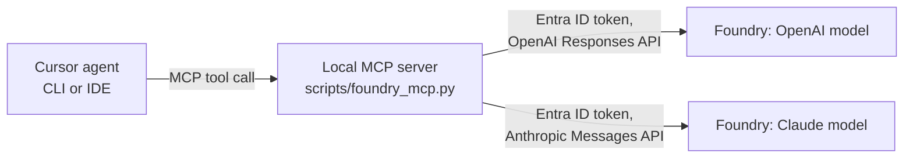

# Set up Microsoft Foundry for Cursor

Every Cursor surface on this site uses the same foundation: an **OpenAI**
model (GPT-6 Luna in the example) and an **Anthropic Claude** model (Claude
Haiku 5.5 in the example) deployed in **Microsoft Foundry**, plus a small local
MCP server that calls them with your Azure CLI login. Do this page once, then
connect the surface you use:

| Surface | Steps on this page you need | Then continue with |
| --- | --- | --- |
| Cursor CLI (MCP fallback) | 1 to 7 | [Cursor CLI](cli.md#fallback-foundry-models-as-mcp-tools) |
| Cursor IDE, partial switch with your own key | 1 to 3, then [API-key access](#optional-api-key-access-for-the-ide-full-switch) | [Cursor IDE, route 1](ide.md#route-1-the-azure-openai-slot) |
| Cursor IDE, Foundry models as MCP tools | 1 to 7 | [Cursor IDE fallback](ide.md#fallback-foundry-models-as-mcp-tools) |
| Cursor Cloud Agents (MCP blueprint) | 1 to 5 | [Cursor Cloud Agents](cloud.md#fallback-foundry-models-as-mcp-tools) |

Every command below was run during the investigation. The outputs shown are
from real runs.

> **Tested on:** Windows 11, PowerShell 7.6, Python 3.12 and Azure CLI 2.93
> (17 November 2026). The scripts use cross-platform PowerShell 7 and should
> work on macOS and Linux, but those platforms were not tested.

## What you are building



The MCP server gives Cursor two tools:

| Tool | Calls | API used |
| --- | --- | --- |
| `foundry_openai` | Your OpenAI model deployment | OpenAI Responses API (`/openai/v1/`) |
| `foundry_claude` | Your Claude model deployment | Native Anthropic Messages API (`/anthropic`) |

The server signs in with your Azure CLI login (Microsoft Entra ID). No API key
is created, copied or stored, and the Azure credential never reaches Cursor.

> **Know the limits before you start.** The MCP server is the **fallback**, not
> a switch: Cursor's own agent model still runs on Cursor's service and is
> billed by Cursor, and your Foundry models do the work you delegate to them
> through the tools. As of November 2026, no Cursor surface can send its
> **main** model traffic to Foundry Claude, and only the IDE has a setting
> (with your own API key, on a paid plan) for Foundry OpenAI-format models.
> [Full switch](fullswitch.md) compares Cursor with Claude Code's Foundry
> mode, and the [IDE page](ide.md#route-1-the-azure-openai-slot) has the key
> routes.

## 1. Prerequisites

- An Azure subscription with a **Microsoft Foundry resource** and a
  **project**. Claude models need a paid subscription with a pay-as-you-go
  billing method and access to Azure Marketplace. Free trial, student,
  credit-only sponsored and CSP subscriptions are not supported for Claude.
  ([Microsoft Learn](https://learn.microsoft.com/azure/foundry/foundry-models/how-to/use-foundry-models-claude))
- [Azure CLI](https://learn.microsoft.com/cli/azure/install-azure-cli), signed in:

  ```powershell
  az login
  az account set --subscription <subscription-id>
  ```

- [PowerShell 7](https://learn.microsoft.com/powershell/scripting/install/installing-powershell)
  (`pwsh`), [Python 3.12+](https://www.python.org/downloads/) and Git.
- The Cursor surface you plan to use. Installation is covered on the
  [CLI](cli.md#1-install-and-sign-in) and [IDE](ide.md#before-you-start)
  pages. A free Cursor account is enough for the MCP tools.

## 2. Get the code and create your configuration

```powershell
git clone https://github.com/webmaxru/cursor-microsoft-foundry.git
cd cursor-microsoft-foundry
Copy-Item config/foundry.example.json config/foundry.json
```

Look up your values:

```powershell
az account show --query id -o tsv
az cognitiveservices account list --query "[?kind=='AIServices'].{name:name, resourceGroup:resourceGroup, location:location}" -o table
az cognitiveservices account project list -g <resource-group> -n <resource> --query "[].name" -o tsv
```

The last command prints `<resource>/<project>`. Use the part after the slash
as `project_name`.

Edit `config/foundry.json`:

| Key | What to put there |
| --- | --- |
| `subscription_id` | Your subscription ID |
| `resource_group` | Resource group of the Foundry resource |
| `account_name` | Foundry resource name |
| `project_name` | Foundry project name |
| `project_endpoint` | `https://<resource>.services.ai.azure.com/api/projects/<project>` |
| `base_url` | `https://<resource>.openai.azure.com/openai/v1/` (OpenAI v1 endpoint) |
| `deployment_name` | Name of your **OpenAI** model deployment |
| `model_name`, `model_version` | OpenAI model and version, for example `gpt-6-luna` and `2026-09-22` |
| `sku_name`, `capacity` | Used only by the deploy script, for example `DataZoneStandard` and `10` |
| `anthropic_base_url` | `https://<resource>.services.ai.azure.com/anthropic` |
| `claude_deployment_name` | Name of your **Claude** model deployment |
| `claude_model_name`, `claude_model_version` | Claude model and version, for example `claude-haiku-5-5` and `2` |

`config/foundry.json` contains no secrets, but it identifies your Azure
resources. It is listed in `.gitignore`, so it isn't committed.

## 3. Deploy an OpenAI model

See which OpenAI models your resource offers:

```powershell
az cognitiveservices account list-models -g <resource-group> -n <resource> --query "[?format=='OpenAI' && starts_with(name, 'gpt-6')].{name:name, version:version}" -o table
```

```text
Name           Version
-------------  ----------
gpt-6-astra    2026-09-03
gpt-6-luna     2026-09-22
gpt-6-sol      2026-09-22
gpt-6.1-sol    2026-09-29
gpt-6.1-terra  2026-10-26
```

**Option A: use the script.** It reads `config/foundry.json`, checks that the
model, version, SKU and quota are available, and then creates the deployment.
If a matching deployment already exists, it changes nothing. If a deployment
with that name exists with different settings, it stops without changing it.

```powershell
./scripts/Deploy-OpenAIModel.ps1
```

**Option B: use the Azure CLI directly.**

```powershell
az cognitiveservices account deployment create -g <resource-group> -n <resource> `
  --deployment-name cursor-poc-gpt-6-luna --model-name gpt-6-luna --model-version 2026-09-22 `
  --model-format OpenAI --sku-name DataZoneStandard --sku-capacity 10
```

**Option C: use the [Foundry portal](https://ai.azure.com):**
**Build > Catalog > Model Catalog**, choose the model, then **Deploy**.

A capacity of 10 gives roughly 10 requests and 10,000 tokens per minute. That
is a rate limit, **not a spending limit**. Standard deployments bill per token.

> The `foundry_openai` tool sends `reasoning: {"effort": "none"}`, which
> GPT-6 Luna accepts. If your OpenAI model rejects that value with HTTP 400,
> change `request_body` in `scripts/foundry_client.py`.

## 4. Deploy a Claude model

Claude models are deployed through Azure Marketplace. The portal is the
documented path:

1. Sign in to [Microsoft Foundry](https://ai.azure.com) with **New Foundry**
   turned on.
2. Go to **Build > Catalog > Model Catalog** and select a Claude model, for
   example **Claude Haiku 5.5**.
3. Select **Deploy > Custom settings**.
4. Read the Azure Marketplace terms, choose an industry, and select
   **Agree and Proceed**.
5. Pick the model version. **2: Hosted on Azure** is the default where both
   versions exist.
6. Keep or change the deployment name. Choose the region scope: **Global**,
   or **Data Zone** where available.
7. Select **Deploy** and wait for the status to show **Succeeded**.

You need **Contributor** or **Owner** on the resource group to deploy.
To deploy with Bicep or Terraform, see the
[Claude on Foundry starter kit](https://github.com/Azure-Samples/claude).

Put the deployment name in `claude_deployment_name`. To see which Claude
models and versions your resource offers:

```powershell
az cognitiveservices account list-models -g <resource-group> -n <resource> --query "[?format=='Anthropic'].{name:name, version:version}" -o table
```

> The PoC reused an existing Claude Haiku 5.5 deployment (version `2`, Global
> Standard), so the deployment steps above come from
> [Microsoft Learn](https://learn.microsoft.com/azure/foundry/foundry-models/how-to/use-foundry-models-claude)
> and were not repeated here.

## 5. Grant yourself inference access

Keyless (Entra ID) inference requires the **Cognitive Services User** role on
the Foundry resource. Owner and Contributor do **not** include inference
permission. **Cognitive Services OpenAI User** covers only OpenAI models, so
the Claude tool would fail with it.
([Microsoft Learn](https://learn.microsoft.com/azure/foundry/foundry-models/how-to/configure-entra-id))

```powershell
$me = az ad signed-in-user show --query id -o tsv
$scope = az cognitiveservices account show -g <resource-group> -n <resource> --query id -o tsv
az role assignment create --assignee-object-id $me --assignee-principal-type User --role "Cognitive Services User" --scope $scope
```

Role assignments can take **five minutes or more** to take effect. The test
account already had this role, so the assignment command was not run during
this investigation.

## 6. Install the bridge

```powershell
./scripts/Setup.ps1
```

This creates `.venv`, installs the pinned packages from
`requirements.lock.txt`, and writes `demo/.cursor/mcp.json` with absolute
paths for your machine:

```json
{
  "mcpServers": {
    "foundry-models": {
      "type": "stdio",
      "command": "/absolute/path/to/cursor-microsoft-foundry/.venv/bin/python",
      "args": ["/absolute/path/to/cursor-microsoft-foundry/scripts/foundry_mcp.py"]
    }
  }
}
```

Cursor CLI and the Cursor IDE both read this file from the `demo` folder. Run
the script again whenever you move the repository.

## 7. Test Foundry without Cursor

Pick the virtual environment's Python for your OS:

```powershell
$py = if ($IsWindows) { './.venv/Scripts/python.exe' } else { './.venv/bin/python' }
```

Call each model directly, then through the MCP server:

```powershell
& $py scripts/smoke_test.py --transport direct --model openai
& $py scripts/smoke_test.py --transport direct --model claude
& $py scripts/smoke_test.py --transport mcp --model openai
& $py scripts/smoke_test.py --transport mcp --model claude
```

Each test sends a random arithmetic task with a one-time marker and checks
the exact answer. A pass prints a JSON record like this (shortened):

```json
{
  "test": "direct",
  "model": "openai",
  "passed": true,
  "expected": "NONCE_4e22c9113a906319:1602",
  "result": {
    "route": "Microsoft Foundry / Azure OpenAI Responses API",
    "authentication": "Microsoft Entra ID via Azure CLI",
    "deployment": "cursor-poc-gpt-6-luna",
    "response_id": "resp_09c284553f6f4302016afb967584f0819596652225004508af",
    "status": "completed",
    "text": "NONCE_4e22c9113a906319:1602"
  }
}
```

Fix any failure here before you connect Cursor; see
[troubleshooting](#8-troubleshooting). Then continue with your surface:
[CLI](cli.md), [IDE](ide.md) or [Cloud Agents](cloud.md).

## Optional: API-key access for the IDE full switch

Everything above uses Entra ID, which Cursor can't use. The IDE's own-key
routes need a **resource API key** instead, and Cursor sends that key to its
own servers with every request (see
[all the disadvantages](ide.md#all-the-disadvantages)). Skip this section if
you only use the MCP fallback.

Check that key access is on. `false` means keys work; `true` means an admin
has disabled them, and you need their approval to change it:

```powershell
az cognitiveservices account show -g <resource-group> -n <resource> --query properties.disableLocalAuth -o tsv
```

The test resource already returned `false`, so no change was needed here.

Copy the key to the clipboard without printing it, paste it into Cursor's
key field, then clear the clipboard:

```powershell
az cognitiveservices account keys list -g <resource-group> -n <resource> --query key1 -o tsv | Set-Clipboard
# paste into Cursor, then:
Set-Clipboard -Value ' '
```

Treat the key like a password. It works for every deployment on the resource,
Cursor's servers see it, and anyone holding it bypasses Entra ID access
control. If it was exposed, rotate it with
`az cognitiveservices account keys regenerate`.

To confirm Foundry accepts the key on the routes Cursor would use, run
`scripts/probe_fullswitch_routes.py`. It reads the key from `az` (or from the
`FOUNDRY_API_KEY` variable), never prints it, and checks 12 route and format
cases. The [IDE page](ide.md#what-the-route-probe-shows) shows the results.

## 8. Troubleshooting

These problems happen before Cursor is involved. Surface-specific problems are
on the [CLI](cli.md#troubleshooting) and [IDE](ide.md#troubleshooting) pages.

| Symptom | Cause and fix |
| --- | --- |
| `FileNotFoundError: Missing ...config/foundry.json` | Copy `config/foundry.example.json` to `config/foundry.json` ([step 2](#2-get-the-code-and-create-your-configuration)). |
| `ValueError: base_url must be ...` | `base_url` must be exactly `https://<account_name>.openai.azure.com/openai/v1/`. The scripts assume the resource's custom subdomain equals its name, which is the default for Foundry resources. |
| HTTP 401 or 403 | Assign **Cognitive Services User** ([step 5](#5-grant-yourself-inference-access)) and wait. Check that `az account show` lists the subscription in your config. |
| HTTP 404 `DeploymentNotFound` | The deployment name in the config doesn't match the deployment. |
| HTTP 400 about `reasoning.effort` | The OpenAI model doesn't accept `none` (see [step 3](#3-deploy-an-openai-model)). Claude rejects `none` on the Responses API; the Claude tool uses native Messages and isn't affected. |
| HTTP 404 `api_not_supported` for Claude | The Claude deployment returned 404 on both Chat Completions routes. Use Anthropic Messages, as the tool does. |
| HTTP 429 | Your deployment capacity is low. Run tests one at a time or raise capacity. |
| Key auth: HTTP 401 | The key is wrong or was rotated, or key access is disabled (`disableLocalAuth` is `true`). Both the `api-key` and `Authorization: Bearer` headers accept the key on OpenAI routes. |
| Key auth: HTTP 400 mentioning `max_completion_tokens` | The model rejects the legacy `max_tokens` field on Chat Completions. Use `max_completion_tokens`. |
| Key auth: HTTP 400 mentioning function tools and `reasoning_effort` | Luna rejects tools on Chat Completions unless `reasoning_effort` is `none`. Use Responses or set `none`. |
| Key auth: HTTP 404 `api_not_supported` for Claude on `/openai/v1/chat/completions` | Claude isn't served on Chat Completions. Use `/anthropic/v1/messages` or a [gateway](ide.md#route-3-claude-through-a-gateway). |
| Windows: "The system cannot find the path specified" | Run `./scripts/Setup.ps1` again to rewrite absolute paths. |

## 9. Clean up

Disconnect each surface first ([CLI](cli.md#disconnect),
[IDE](ide.md#clean-up)). Then delete only the OpenAI deployment you created
for this guide:

```powershell
az cognitiveservices account deployment delete -g <resource-group> -n <resource> --deployment-name <openai-deployment-name>
```

Delete the Claude deployment the same way if you created it only for this
guide. Nothing else runs in the background: the MCP server starts and stops
with each Cursor session.
